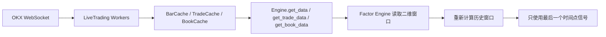
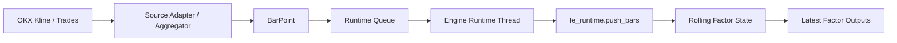
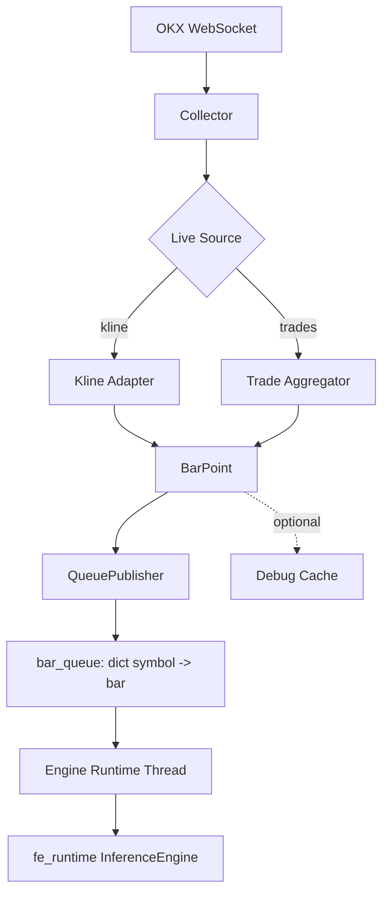
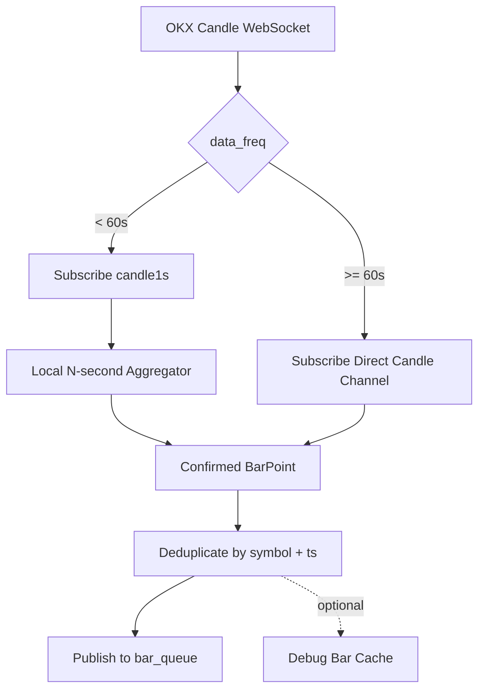
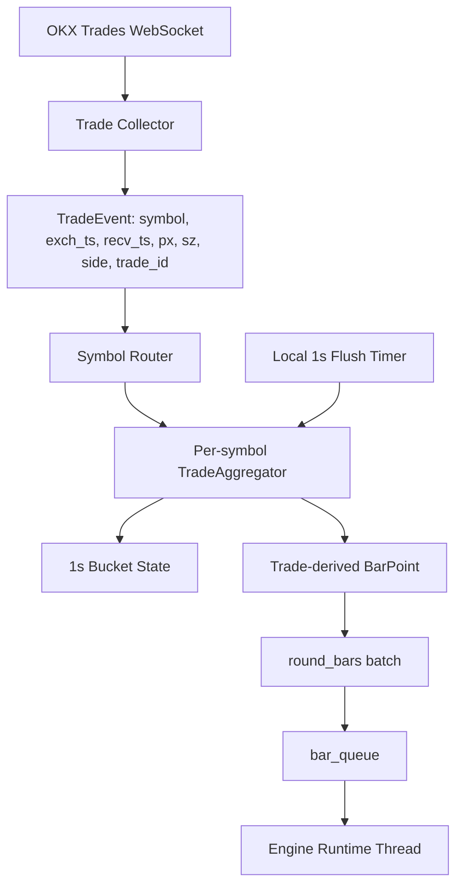
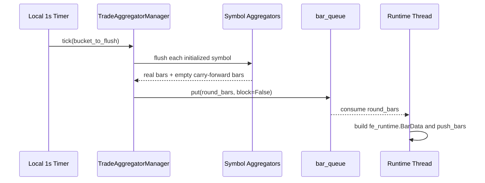
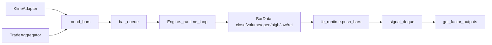
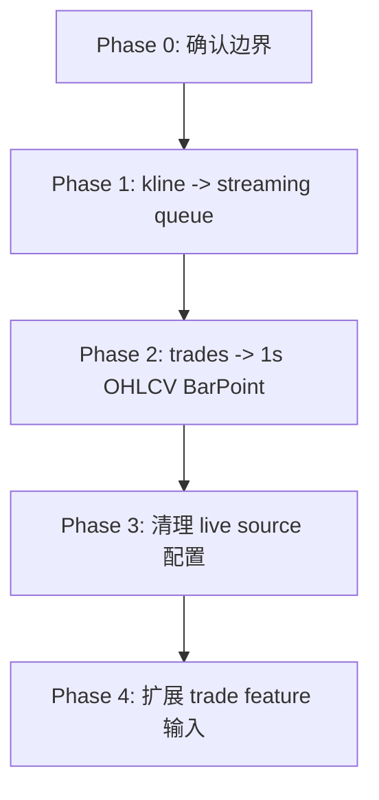

# LiveTrading 流式数据流重构设计

> 日期: 2026-04-29
> 范围: `dataflow/livetrading` 下一阶段重构设计
> 状态: 设计草案, 暂不写实现

---

## 1. 这份文档要解决什么问题

现在需要重新定义 `dataflow/livetrading`。

旧版 `livetrading` 的核心假设是 batch / snapshot 计算:

```text
OKX WebSocket
    -> livetrading worker
    -> numpy cache
    -> engine.get_data()
    -> factor engine 拿二维数组计算
    -> 只取最后一个时间点的信号
```

也就是说, 对每个 symbol:

```text
get_data()[symbol] = shape-(N, F) 二维数组
```

然后 factor engine 会拿这段历史窗口重新算一遍因子, 最后只使用最后一个时间点的输出。

这种方式的问题是:

- 每次计算都要复制窗口数据
- 每次计算都重复处理历史
- 前面 N-1 个时间点的输出大部分会被丢掉
- dataflow 和 factor engine 之间是“拉快照”, 不是“推增量”
- 这和现在的 `fe_runtime` 流式因子图不匹配

现在的因子引擎已经变成 streaming 模型:

```text
每来一个新的规则输入点
    -> push 到 queue
    -> fe_runtime 增量更新 rolling state
    -> 输出最新因子
```

所以 `livetrading` 也应该重构成:

```text
真实市场数据
    -> source adapter
    -> regular market point
    -> queue
    -> streaming factor engine
```

核心变化是:

> `livetrading` 不再以 `get_data()` 的二维窗口快照作为主产品, 而是以流式 `MarketDataPoint` / `BarPoint` 作为主产品。

---

## 2. 当前结论

第一阶段只支持两类 live 输入源:

```text
1. K线数据
2. Trades 数据聚合出来的 bar-like 数据
```

暂时不支持 order book:

```text
不设计 get_book_data()
不设计 books5 feature
不设计 order book level 数据
```

order book 之后单独设计, 不进入当前重构范围。

---

## 3. 新旧架构对比

### 3.1 旧架构: batch snapshot

```text
OKX kline / trades / books
    -> workers
    -> BarCache / TradeCache / BookCache
    -> Engine.get_data() / get_trade_data() / get_book_data()
    -> Python 或 C++ 因子计算读取整段窗口
```



这个架构的中心是 cache。

cache 是计算输入。

### 3.2 新架构: streaming point

```text
OKX kline / trades
    -> source-specific adapter
    -> regular point
    -> runtime queue
    -> fe_runtime.push_bars()
    -> signal buffer
```



这个架构的中心是 queue。

queue 里的增量点是计算输入。

cache 如果还存在, 只能是辅助用途:

- debug
- replay inspection
- manual monitoring
- smoke test

cache 不能再是 factor engine 的主输入路径。

---

## 4. 重构目标

### 4.1 目标一: live dataflow 直接喂流式因子引擎

最终应该支持:

```python
Engine(
    mode="live",
    live_source="kline",
    factor_group="okx_perp",
)
```

以及:

```python
Engine(
    mode="live",
    live_source="trades",
    factor_group="okx_perp",
)
```

这两种模式都应该能让 runtime thread 持续收到新的 bar-like point。

### 4.2 目标二: kline 和 trades 是两个 source, 但输出统一

两条路径不同:

```text
Kline:
    OKX candle
        -> KlineAdapter
        -> BarPoint

Trades:
    OKX raw trades
        -> TradeAggregator
        -> BarPoint
```

但进入 factor engine 前要统一:

```text
BarPoint:
    ts
    symbol
    open
    high
    low
    close
    volume
    vol_ccy
    vol_ccy_quote
```

第一版先保持这个 schema, 因为当前 `fe_runtime.BarData` 只支持:

```text
close, volume, open, high, low, ret
```

### 4.3 目标三: 不让因子引擎直接处理 raw trades

raw trades 是不规则事件流:

```text
12:00:00.001 trade
12:00:00.003 trade
12:00:00.080 trade
12:00:00.500 trade
```

当前因子引擎更适合规则时间序列:

```text
12:00:00 bar
12:00:01 bar
12:00:02 bar
```

所以 trades 必须先经过聚合:

```text
raw trades
    -> per-symbol 1s TradeAggregator
    -> trade-derived OHLCV bar
    -> factor queue
```

---

## 5. 新的 live dataflow 分层

建议把 live dataflow 拆成这些概念层:

```text
Collector
    只负责接 OKX websocket 和解析原始消息

Adapter / Aggregator
    把上游事件变成规则 BarPoint

Publisher
    把 BarPoint 或 round_bars 推进 runtime queue

Optional Debug Cache
    可选保存最近数据, 但不参与主计算路径
```

整体流向:

```text
OKX WebSocket
    -> Collector
    -> Adapter / Aggregator
    -> BarPoint
    -> QueuePublisher
    -> Engine runtime thread
    -> fe_runtime
```



---

## 6. K线数据设计

K线是简单路径。

### 6.1 输入

来自 OKX candle stream:

```text
candle1s
candle1m
candle5m
...
```

当前已有逻辑:

```text
data_freq < 60s
    -> 订阅 candle1s
    -> 本地聚合 N 秒

data_freq >= 60s
    -> 直接订阅 OKX 对应 candle channel
```

这个可以保留。



### 6.2 输出

每当一根 confirmed candle 完成, 输出一个 `BarPoint`:

```text
BarPoint(
    source="kline",
    symbol=symbol,
    ts=bar_ts,
    open=o,
    high=h,
    low=l,
    close=c,
    volume=vol,
    vol_ccy=vol_ccy,
    vol_ccy_quote=vol_ccy_quote,
)
```

然后发布到 runtime queue。

### 6.3 必须加的保护

流式 runtime 是有状态的, 所以 K线路径必须避免错误 push:

- 只处理 confirmed candle
- 每个 symbol 记录 `last_pushed_ts`
- 相同 timestamp 不重复 push
- 老 timestamp 不 push
- 发现 timestamp gap 时记录 counter / warning

旧 batch 模式里重复 cache row 只是污染窗口。

新 streaming 模式里重复 push 会永久污染 rolling state。

---

## 7. Trades 数据设计

Trades 是这次重构最重要的部分。

### 7.1 为什么不能直接 push raw trades

raw trades 是不规则的。

如果每笔 trade 都 push 给 factor engine:

- 输入频率太高
- 不同 symbol 时间轴不齐
- rolling window 的含义会变复杂
- 当前 factor graph 不支持 irregular event time

所以第一版不这么做。

### 7.2 第一版方案: 1s trade bar



每个 symbol 一个聚合器:

```text
TradeAggregator(symbol, interval_ms=1000)
```

它接收:

```text
TradeEvent:
    symbol
    exch_ts_ms
    recv_ts_ms
    px
    sz
    side
    trade_id
```

输出:

```text
Trade-derived BarPoint:
    ts = bucket_start_ms
    open
    high
    low
    close
    volume
    vol_ccy
    vol_ccy_quote
```

### 7.3 bucket 定义

使用 exchange timestamp 做 bucket:

```text
bucket_start_ms = floor(exch_ts_ms / 1000) * 1000
bucket_end_ms   = bucket_start_ms + 1000
```

不要用本地 receive time 作为聚合时间。

但要保留 `recv_ts_ms`, 用于监控延迟:

```text
latency_ms = recv_ts_ms - exch_ts_ms
```

### 7.4 聚合状态

每个 symbol 维护当前 bucket:

```text
current_bucket_start_ms
open
high
low
close
volume
vol_ccy
buy_volume
sell_volume
trade_count
buy_count
sell_count
last_close
```

第一版对外只发 OHLCV 相关字段。

`buy_volume`, `sell_volume`, `trade_count` 可以先内部统计, 之后扩展因子输入时再暴露。

### 7.5 flush 策略

不要依赖 OKX kline 到达来触发 trade flush。

建议使用本地 timer:

```text
每 1 秒:
    for each symbol:
        flush 已结束 bucket
        生成 BarPoint
    组成 round_bars
    推入 runtime queue
```

这样 trades path 会接近 simulation path:

```text
一次本地 tick
    -> 每个已初始化 symbol 一个点
    -> 一个 round_bars
```



### 7.6 空 bucket 策略

如果某个 symbol 在某一秒没有 trade, 但已经有 `last_close`, 仍然发一根 empty bar:

```text
open = last_close
high = last_close
low = last_close
close = last_close
volume = 0
vol_ccy = 0
vol_ccy_quote = 0
```

这样 factor engine 看到的是规则时间序列。

如果 symbol 启动后还没有任何 trade, 没有 `last_close`, 就先不发。

### 7.7 late trade 策略

第一版不做回滚。

如果 trade 属于已经 flush 并 push 过的 bucket:

```text
drop
```

只记录统计:

```text
late_trade_count
late_trade_max_delay_ms
```

不要对每笔 late trade 打日志, 否则线上会很吵。

---

## 8. Queue 语义

当前 runtime loop 需要的是:

```python
round_bars: dict[str, np.ndarray]
```

第一版继续使用这个格式。



### 8.1 Kline source

Kline 到达是异步的。

第一版允许 partial round:

```python
{"BTC-USDT-SWAP": bar}
```

也就是哪个 symbol 的 confirmed candle 到了, 就 push 哪个 symbol。

### 8.2 Trades source

Trades 使用本地 timer flush。

第一版尽量每秒推一个包含多个 symbol 的 batch:

```python
{
    "BTC-USDT-SWAP": btc_bar,
    "ETH-USDT-SWAP": eth_bar,
    "SOL-USDT-SWAP": sol_bar,
}
```

只包含已经初始化过价格的 symbol。

### 8.3 是否要等所有 symbol

第一版不强制等所有 symbol。

原因:

- 有些 symbol 启动后可能迟迟没有 trade
- websocket 可能断线
- 强等会阻塞整个因子更新

规则是:

```text
有可用 BarPoint 的 symbol 就进入本轮 batch
没有初始化价格的 symbol 跳过
已经初始化但无 trade 的 symbol 发 empty bar
```

### 8.4 backpressure

queue 满了不要阻塞数据线程。

策略:

```python
bar_queue.put(round_bars, block=False)
```

如果满了:

```text
drop 当前 round
计数
周期性 warning
```

阻塞 websocket / aggregator 比丢一轮更危险。

---

## 9. Engine 接口方向

旧参数里有:

```python
enable_bars
enable_trades
enable_books
```

这些更像旧 snapshot 架构的开关。

新 streaming 架构建议引入更明确的 source 参数:

```python
Engine(
    mode="live",
    live_source="kline",   # "kline" | "trades"
    factor_group="okx_perp",
)
```

或者更明确:

```python
Engine(
    mode="live",
    live_bar_source="kline",   # "kline" | "trades"
)
```

第一版只允许二选一:

```text
kline
trades
```

不支持:

```text
kline+trades
books
```

---

## 10. get_data / cache 的新定位

旧设计里:

```text
get_data() 是 factor engine 的输入
```

新设计里:

```text
queue 是 factor engine 的输入
```

所以 `get_data()` 如果保留, 只能是 debug / monitoring API。

它不应该再出现在主计算链路里。

建议定位:

```text
get_data()
    可选返回最近 BarPoint 缓存
    用于人工检查和测试
    不参与 streaming factor inference

get_trade_data()
    可选返回 raw trades 最近缓存
    用于检查和未来研究
    不参与第一版 factor inference

get_book_data()
    当前阶段不维护
```

如果为了兼容暂时不删除方法, 也应该在文档和代码注释里标清:

```text
legacy / debug only
```

---

## 11. 新 livetrading 模块建议

可以考虑把新的 live dataflow 按 source 重组。

建议方向:

```text
dataflow/livetrading/
    manager.py
    queue.py
    schemas.py

    kline/
        collector.py
        adapter.py
        worker.py

    trades/
        collector.py
        aggregator.py
        worker.py
```

职责:

```text
collector.py
    只接 websocket, 解析 OKX payload

adapter.py / aggregator.py
    负责把事件变成 BarPoint

worker.py
    管理线程 / asyncio loop / timer / queue publish

manager.py
    根据 live_bar_source 选择启动哪条 source
```

旧的 `bars`, `trades`, `books` 结构可以逐步迁移, 不必强行在原结构里修补。

---

## 12. 分阶段开发计划

### Phase 0: 确认设计边界

先确认:

- 当前阶段不做 order book
- 当前阶段不做 kline + trades merge
- 当前阶段不扩展 runtime 输入字段
- 当前阶段目标是让 live source 直接 push streaming queue

输出:

- 本设计文档
- 后续实现 checklist

### Phase 1: 重构 kline streaming path

目标:

```text
OKX kline
    -> BarPoint
    -> bar_queue
    -> fe_runtime
```

任务:

- 给 live kline worker 增加 queue publisher
- 去掉对 batch `get_data()` 主路径的依赖
- 增加 `last_pushed_ts_by_symbol`
- 处理 duplicate / old candle
- 使用 synthetic payload 写单元测试

验收:

```text
Engine(mode="live", live_bar_source="kline", factor_group=...)
```

能持续更新 `get_factor_outputs()`。

### Phase 2: 实现 trades -> 1s OHLCV bar



目标:

```text
OKX trades
    -> TradeAggregator
    -> 1s BarPoint
    -> bar_queue
    -> fe_runtime
```

任务:

- trade collector 保留 `exch_ts_ms`, `recv_ts_ms`, `trade_id`
- 实现 per-symbol `TradeAggregator`
- 实现 timer-driven flush
- 实现 empty bucket carry forward
- 实现 late trade drop counter
- 输出现有 8 列 bar schema
- 写 aggregator 单元测试

验收:

```text
Engine(mode="live", live_bar_source="trades", factor_group=...)
```

能用 trade-derived bars 驱动因子输出。

### Phase 3: 清理 live source 配置

目标:

让 live mode 的配置语义清楚。

任务:

- 引入 `live_bar_source`
- 校验非法组合
- 文档化 `kline` 和 `trades` 两种 source
- 将 `enable_books` 从当前主路径移除

### Phase 4: 扩展 trade feature 输入

这一步以后再做。

可能新增:

```text
vwap
buy_volume
sell_volume
signed_volume
trade_count
buy_count
sell_count
volume_imbalance
realized_vol
```

这会要求改 runtime:

- `BarData`
- `Op` input enum
- `FactorGraph::add_input`
- pybind
- factor builders

不要在 Phase 1/2 做这个。

---

## 13. 需要提前定的问题

实现前需要确认:

1. 参数名用 `live_source` 还是 `live_bar_source`?
2. kline 是否仍然作为默认 live source?
3. trades 默认使用 `trades` 还是 `trades-all`?
4. trade bar interval 第一版是否固定 1s?
5. `get_data()` 是否保留为 debug API?
6. 是否需要 raw trade cache?
7. `bar_count` 统计 point 数还是 round 数?
8. queue 满了时是否直接 drop round?

---

## 14. 一句话总结

这次不是给旧 `livetrading` 加一个小功能。

这次应该把 `livetrading` 从:

```text
batch snapshot cache producer
```

重构成:

```text
streaming market point producer
```

K线天然接近 `BarPoint`。

Trades 需要先聚合成 1s `BarPoint`。

Order book 暂时不进入设计。

Factor engine 不再从 `get_data()` 复制二维数组计算, 而是持续消费 live dataflow 推来的增量点。
