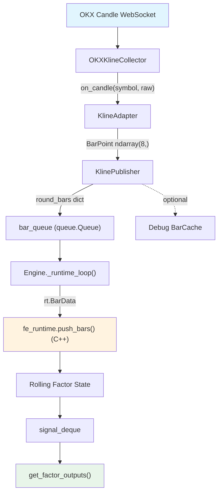

# Kline Live Dataflow → Factor Engine 全链路讲解

> 日期: 2026-05-03
> 范围: 从 OKX K线 WebSocket 到因子输出的完整数据流路径
> 配合代码阅读

---

## 0. 一句话概述

```text
OKX candle WS → OKXKlineCollector → KlineAdapter → KlinePublisher → bar_queue → Engine._runtime_loop → fe_runtime.push_bars → signal_deque → get_factor_outputs()
```

整条链路的核心思想: **推增量, 不拉快照**。每一根 confirmed K线到达后, 立即以 `BarPoint` 的形式推入 `bar_queue`, 由 runtime thread 消费并驱动 C++ 因子图的 rolling state 更新。

---

## 1. 全链路架构图



涉及三个线程:

| 线程 | 名称 | 职责 |
|------|------|------|
| `okx-kline` | KlineWorker 内部 | 运行 asyncio loop, 接收 WS 消息, 调用 adapter + publisher |
| `factor-infer` | Engine 内部 | 从 bar_queue 拉数据, 调用 C++ push_bars, 写 signal_deque |
| main thread | 用户代码 | 调用 `get_factor_outputs()` 读取最新因子值 |

---

## 2. 逐层代码讲解

### 2.1 OKXKlineCollector — WebSocket 连接与消息解析

**文件**: `dataflow/okx/kline/collector.py`

**职责**: 只管 WebSocket 连接生命周期 (连接、订阅、断线重连) 和 JSON 解析。不做任何数据处理。

```python
class OKXKlineCollector:
    def __init__(
        self,
        symbols: list[str],
        on_candle: Callable[[str, list], None],  # callback(symbol, raw_candle)
        channel: str = "candle1s",
    ): ...
```

**关键方法 `_dispatch`**:

收到 OKX 推送的 JSON 消息后, 解析出 `instId` (symbol) 和 candle 数组, 然后逐条回调:

```python
def _dispatch(self, raw_text: str):
    payload = json.loads(raw_text)
    records = payload.get("data")
    symbol = payload.get("arg", {}).get("instId", "")
    for record in records:
        self.on_candle(symbol, record)
```

OKX 的 candle 原始格式:

```text
["1704067200000", "42000.5", "42100.0", "41900.0", "42050.0", "123.45", "5189017.25", "5189017.25", "1"]
   ts (ms)          open       high       low        close      vol       volCcy       volCcyQuote  confirm
```

最后一个字段 `"1"` 表示这根 candle 已经 confirmed (收盘)。`"0"` 表示还在 in-progress。

**重连机制**: 断线后等待 3-5 秒自动重连, 在 `_ws_loop` 里通过 `while self._running` 循环实现。

---

### 2.2 KlineAdapter — Confirmed 过滤 + N 秒聚合

**文件**: `dataflow/okx/kline/adapter.py`

**职责**: 把 OKX 的 candle 原始数组转换为 `BarPoint`, 可选做 N 秒聚合。

```python
class KlineAdapter:
    def __init__(self, freq_seconds: int): ...

    def on_candle(self, symbol: str, raw: list) -> np.ndarray | None:
```

**BarPoint 格式** — 核心数据结构, 贯穿整条链路:

```text
np.ndarray shape=(8,) dtype=float64
index: [0:ts, 1:open, 2:high, 3:low, 4:close, 5:vol, 6:vol_ccy, 7:vol_ccy_quote]
```

这个格式和 simulation 路径 (`BarGenerator.next_bar()`) 完全一致。

**两种工作模式**:

```text
freq_seconds >= 60  →  直连模式
    订阅 candle1m / candle5m / ...
    confirmed candle → 直接输出 BarPoint

freq_seconds < 60   →  聚合模式
    订阅 candle1s
    每个 symbol 维护一个 buffer
    攒够 N 根 confirmed 1s candle → 合并输出一根 N 秒 BarPoint
```

**聚合逻辑** (`_merge` 方法):

```python
@staticmethod
def _merge(buf: list[np.ndarray]) -> np.ndarray:
    return np.array([
        buf[0][0],                    # ts   = 第一根 candle 的时间戳
        buf[0][1],                    # open = 第一根的 open
        max(b[2] for b in buf),       # high = 所有 candle 的最高
        min(b[3] for b in buf),       # low  = 所有 candle 的最低
        buf[-1][4],                   # close = 最后一根的 close
        sum(b[5] for b in buf),       # vol   = 求和
        sum(b[6] for b in buf),       # vol_ccy = 求和
        sum(b[7] for b in buf),       # vol_ccy_quote = 求和
    ], dtype=np.float64)
```

**Gap 检测**: 如果相邻两根 1s candle 的时间差超过 2 秒, 说明中间有断线或丢数据。adapter 会清空 buffer, 从新 candle 重新开始聚合, 避免用不连续的数据聚合出错误的 bar。

---

### 2.3 KlinePublisher — 安全推送到 bar_queue

**文件**: `dataflow/okx/kline/publisher.py`

**职责**: 流式 runtime 是有状态的, 一旦推入错误数据就会永久污染 rolling state。publisher 负责三层保护:

**保护 1 — 去重**:

```python
last_ts = self._last_pushed_ts.get(symbol)
if last_ts is not None and ts <= last_ts:
    self._dup_count += 1
    return False
```

每个 symbol 记录 `last_pushed_ts`, 相同或更早的时间戳直接丢弃。防止 WS 重连后收到重复 candle。

**保护 2 — Gap 告警**:

```python
if last_ts is not None:
    actual_gap = ts - last_ts
    if actual_gap > self._expected_interval_ms * 2:
        self._gap_count += 1
        logger.warning(...)
```

检测到时间跳变时记录计数和日志, 方便监控。

**保护 3 — Backpressure**:

```python
try:
    self._bar_queue.put(round_bars, block=False)
except queue.Full:
    self._drop_count += 1
    return False
```

queue 满了不阻塞 (会卡住 WS 线程), 直接 drop 当前 round, 记录计数。

**推送格式** — 和 simulation 一致:

```python
round_bars = {symbol: bar}  # dict[str, np.ndarray]
self._bar_queue.put(round_bars, block=False)
```

Live 路径是 partial round (每次一个 symbol), simulation 是 full round (每次所有 symbol)。但格式相同, `Engine._runtime_loop()` 不需要区分。

---

### 2.4 KlineWorker — 线程编排

**文件**: `dataflow/okx/kline/worker.py`

**职责**: 管理 daemon 线程, 在线程内运行 asyncio event loop, 组装 collector → adapter → publisher。

```python
class KlineWorker:
    def __init__(self, symbols, bar_queue, freq_seconds=5, debug_cache=None):
        channel, needs_agg = resolve_bar_channel(freq_seconds)
        self._adapter = KlineAdapter(freq_seconds=freq_seconds)
        self._publisher = KlinePublisher(
            bar_queue=bar_queue,
            debug_cache=debug_cache,
            expected_interval_ms=freq_seconds * 1000,
        )
```

**核心回调** — collector 每收到一条 candle 就调用:

```python
def _on_candle(self, symbol: str, raw: list):
    bar = self._adapter.on_candle(symbol, raw)  # filter + aggregate
    if bar is not None:
        self._publisher.publish(symbol, bar)     # dedup + push to queue
        self._bar_count += 1
```

这个回调在 asyncio 线程里同步执行 (adapter 和 publisher 都是纯计算, 非常快)。

---

### 2.5 Engine — 把所有东西连起来

**文件**: `factorengine/engine.py`

**初始化** (live mode):

```python
if mode == "live":
    if self._bar_queue is None:
        self._bar_queue = queue.Queue(maxsize=bar_queue_size)

    self._kline_worker = KlineWorker(
        symbols=symbols,
        bar_queue=self._bar_queue,       # ← publisher 推送目标
        freq_seconds=self.data_freq_seconds,
        debug_cache=self._debug_cache,
    )
```

`bar_queue` 是 Engine 创建的, 传给 KlineWorker, 同时也被 runtime thread 消费。这是两个线程之间的唯一通信通道。

**Runtime loop** — 消费 bar_queue, 驱动 C++ 因子推理:

```python
def _runtime_loop(self):
    while not self._stop_event.is_set():
        round_bars = self._bar_queue.get(timeout=0.5)

        batch = {}
        for sym, bar in round_bars.items():
            ts_ms  = int(bar[0])
            close  = float(bar[4])
            volume = float(bar[5])
            open_  = float(bar[1])
            high   = float(bar[2])
            low    = float(bar[3])

            prev_close = self._prev_closes.get(sym, close)
            ret = (close / prev_close - 1.0) if prev_close != 0 else 0.0

            batch[sym] = rt.BarData(close, volume, open_, high, low, ret)
            self._prev_closes[sym] = close

        self._inference.push_bars(batch)     # C++ parallel push
        result = self._inference.get_all_outputs()
        self._signal_deque.append({
            "ts": ts_ms,
            "bar_index": self._bars_pushed,
            "factors": result,
        })
```

这段代码做了两件事:

1. **格式转换**: `np.ndarray shape-(8,)` → `rt.BarData(close, volume, open, high, low, ret)`
   - 注意 `ret` 是 runtime loop 计算的, 不是 dataflow 提供的
   - `prev_close` 字典记录每个 symbol 的上一根 close
2. **C++ 推理**: `push_bars()` 释放 GIL, 在 C++ 线程池里并行更新所有 symbol 的因子图 rolling state

**读取因子输出** — 用户调用, O(1):

```python
def get_factor_outputs(self):
    if not self._signal_deque:
        return {}
    return self._signal_deque[-1]["factors"]
```

`signal_deque` 是一个 `maxlen=3` 的 deque, runtime thread 写入, main thread 读取。deque 的 append/read 在 CPython 下是 GIL-protected 的, 所以是线程安全的。

---

## 3. 数据格式一览

整条链路只有两次格式转换:

```text
[格式 1] OKX candle raw (list of strings)
    ↓   KlineAdapter._parse_confirmed_bar()
[格式 2] BarPoint: np.ndarray shape=(8,) float64
    [ts, open, high, low, close, vol, vol_ccy, vol_ccy_quote]
    ↓   KlinePublisher.publish() → bar_queue → Engine._runtime_loop()
[格式 3] rt.BarData (C++ struct via pybind11)
    BarData(close, volume, open, high, low, ret)
```

| 格式 | 谁生产 | 谁消费 | 备注 |
|------|--------|--------|------|
| OKX raw | OKX WebSocket | Collector → Adapter | 9 个字段, 最后一个是 confirm 标志 |
| BarPoint | Adapter | Publisher → bar_queue → Engine | 8 个字段, 和 simulation 一致 |
| BarData | Engine._runtime_loop | fe_runtime C++ | 6 个字段, ret 由 Engine 计算 |

---

## 4. 与 Simulation 路径的对比

| 维度 | Simulation | Live Kline |
|------|-----------|------------|
| 数据来源 | `BarGenerator` (随机数) | OKX candle WebSocket |
| 聚合 | 无 (直接生成 N 秒 bar) | `KlineAdapter` 聚合 1s→Ns |
| 推送节奏 | 每轮所有 symbol 同步 | 每个 symbol 独立 (partial round) |
| 线程模型 | `SimBarWorker` daemon thread + sleep | `KlineWorker` daemon thread + asyncio loop |
| bar_queue 格式 | `dict[str, np.ndarray]` | 完全相同 |
| BarPoint 格式 | `ndarray(8,)` | 完全相同 |
| Engine._runtime_loop | 不需要改 | 不需要改 |

核心设计原则: **bar_queue 是 dataflow 和 factor engine 之间的唯一接口, 格式统一, 来源透明**。

---

## 5. 流式安全保护总结

因为 `fe_runtime` 是有状态的 (rolling window), 错误数据会永久污染 state。所以从 collector 到 queue 有多层保护:

```text
Layer 1: OKXKlineCollector
    只转发, 不处理, 保持 WS 数据原样

Layer 2: KlineAdapter
    ✓ 只处理 confirmed candle (raw[-1] == "1")
    ✓ Gap 检测 → 清空聚合 buffer, 避免跨断线聚合
    ✓ 每个 symbol 独立 buffer

Layer 3: KlinePublisher
    ✓ per-symbol last_pushed_ts → 丢弃重复和过期 bar
    ✓ Gap 检测 → 告警日志 + 计数
    ✓ 非阻塞 put → queue 满时 drop, 不卡 WS 线程
    ✓ 所有保护都有计数器 (bars_published / dup_count / gap_count / drop_count)

Layer 4: Engine._runtime_loop
    ✓ 从 queue 消费, 转换格式, 计算 ret
    ✓ push_bars 释放 GIL, C++ 并行处理
```

---

## 6. 运行测试

```bash
cd /path/to/FactorEngine
PYTHONPATH=. python -m pytest tests/dataflow/test_okx_kline_adapter.py \
                               tests/dataflow/test_okx_kline_publisher.py \
                               tests/dataflow/test_okx_kline_e2e.py -v
```

测试覆盖:

| 测试文件 | 测试数 | 覆盖内容 |
|----------|--------|----------|
| `test_okx_kline_adapter.py` | 16 | confirmed 过滤、直连模式、聚合模式、gap 检测、边界情况 |
| `test_okx_kline_publisher.py` | 14 | 正常推送、去重、gap 告警、backpressure、debug cache、线程安全、stats |
| `test_okx_kline_e2e.py` | 6 | adapter→publisher 全链路、queue 格式兼容性、consumer 线程模拟、高压力测试 |

---

## 7. 使用示例

### 7.1 Live mode (需要网络连接 OKX)

```python
from factorengine.engine import Engine

engine = Engine(
    symbols=["BTC-USDT-SWAP", "ETH-USDT-SWAP", "SOL-USDT-SWAP"],
    mode="live",
    data_freq="5s",
    factor_group="okx_perp",
    num_threads=4,
)
engine.start()

import time
time.sleep(30)

# 读取最新因子输出
factors = engine.get_factor_outputs()
for sym, fmap in factors.items():
    print(f"{sym}: {len(fmap)} factors")

# 查看 kline worker 统计
print(engine.kline_stats)
# {'adapter_bar_count': 18, 'bars_published': 18, 'dup_count': 0, 'gap_count': 0, 'drop_count': 0}

# 查看 debug cache 快照
snapshot = engine.get_data()
for sym, arr in snapshot.items():
    print(f"{sym}: {arr.shape}")  # (N, 8)

engine.stop()
```

### 7.2 Simulation mode (不变)

```python
engine = Engine(
    symbols=["BTC-USDT-SWAP", "ETH-USDT-SWAP"],
    mode="simulation",
    sim_seed=42,
    factor_group="okx_perp",
)
engine.start()
time.sleep(10)
factors = engine.get_factor_outputs()
engine.stop()
```

---

## 8. 文件清单

```text
dataflow/okx/
    __init__.py                     package init
    common.py                       OKX WS 地址, channel 映射, 工具函数
    symbols.py                      REST API 查询合约列表

    kline/
        __init__.py                 re-exports
        collector.py                OKXKlineCollector — WS 连接 + JSON 解析
        adapter.py                  KlineAdapter — confirmed 过滤 + N 秒聚合
        publisher.py                KlinePublisher — 去重 + queue 推送 + 保护
        worker.py                   KlineWorker — 线程管理, 组装以上三者

factorengine/
    engine.py                       Engine — live mode 使用 KlineWorker

tests/dataflow/
    test_okx_kline_adapter.py       KlineAdapter 16 个测试
    test_okx_kline_publisher.py     KlinePublisher 14 个测试
    test_okx_kline_e2e.py           端到端 6 个测试
```
