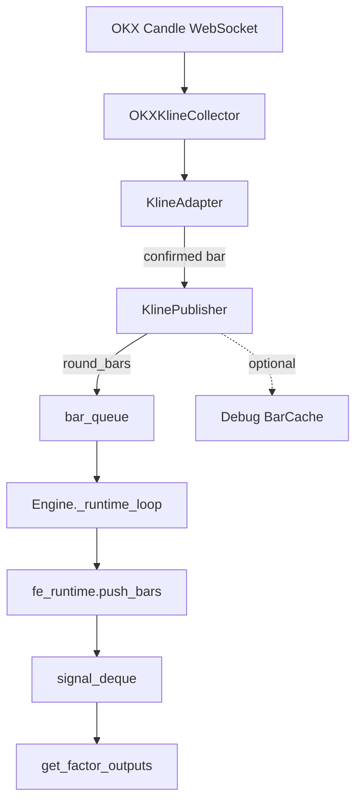

# OKX Kline 流式数据流重构 — 开发文档

> 日期: 2026-05-03
> 范围: 新建 `dataflow/okx` 模块, 实现 kline 流式推送到 `fe_runtime`
> 前置文档: `docs/20260429/live_dataflow_streaming_adapter_design.md`
> 状态: 开发计划, 待确认后实施

---

## 1. 背景与动机

### 1.1 当前 live 路径的根本问题

当前 `dataflow/livetrading` 的 kline 路径是:

```text
OKX candle WS
    -> OKXBarCollector._dispatch()
    -> BarDataflowWorker._on_candle_direct() / _on_candle_aggregate()
    -> BarCache.append(symbol, bar)
    [结束]
```

数据到了 `BarCache` 就停了。**没有推入 `bar_queue`**。

而 `Engine._runtime_loop()` 需要从 `bar_queue` 拉数据才能喂给 `fe_runtime`:

```text
bar_queue.get() -> push_bars() -> signal_deque
```

目前只有 simulation 路径正确连接了这条链路:

```text
SimBarWorker._run()
    -> generator.next_bar()
    -> bar_cache.append()
    -> bar_queue.put(round_bars)     ← 这一步 live 完全没有
```

所以当前 `Engine(mode="live", factor_group=...)` 实际上无法工作: runtime thread 永远从 `bar_queue` 拿不到数据。

### 1.2 为什么不在旧代码上修补

`dataflow/livetrading` 的问题不只是缺少 `bar_queue.put()`:

1. **架构假设不同**: 旧代码围绕 `BarCache` 设计, 所有 worker 的终点是 cache, 没有流式 publisher 概念
2. **bars/trades/books 耦合**: `DataflowManager` 混合管理三种数据源, 改一个会影响另外两个
3. **平台绑定**: OKX 特有逻辑 (`livetrading/okx/`) 和通用逻辑 (`livetrading/manager.py`) 交织
4. **无法扩展到其他交易所**: 之后要接 Binance, 在 `livetrading` 里加 `binance/` 子目录会越来越混乱

所以按照设计文档的方向, 直接新建 `dataflow/okx` 作为独立模块。

### 1.3 本次目标

只做 **kline 流式路径**:

```text
OKX candle WS -> KlineAdapter -> bar_queue -> fe_runtime
```

不做:
- trades 聚合
- order book
- C++ BarData 结构体扩展

验收标准:

```python
engine = Engine(
    mode="live",
    symbols=["BTC-USDT-SWAP", "ETH-USDT-SWAP"],
    data_freq="5s",
    factor_group="okx_perp",
)
engine.start()
time.sleep(30)
outputs = engine.get_factor_outputs()
# outputs 应该有因子值, 且持续更新
engine.stop()
```

---

## 2. 参考: simulation 路径如何工作

simulation 路径是目前唯一正确实现流式推送的路径, 是本次重构的参考模型:

```text
SimDataflowManager.__init__()
    创建 BarCache
    创建 BarGenerator (per symbol)
    创建 SimBarWorker(bar_cache, generators, bar_queue)

SimBarWorker._run()              [daemon thread]
    while not stop:
        ts_ms = now()
        round_bars = {}
        for symbol in symbols:
            bar = generator.next_bar(ts_ms)       # shape-(8,) ndarray
            bar_cache.append(symbol, bar)          # 可选 debug
            round_bars[symbol] = bar
        bar_queue.put(round_bars, block=False)     # ← 核心: 推入 queue
        sleep(interval)

Engine._runtime_loop()           [daemon thread]
    while not stop:
        round_bars = bar_queue.get(timeout=0.5)    # ← 从 queue 拉
        batch = {}
        for sym, bar in round_bars.items():
            batch[sym] = rt.BarData(close, volume, open, high, low, ret)
        inference.push_bars(batch)                 # C++ parallel push
        result = inference.get_all_outputs()
        signal_deque.append(result)
```

关键点:

| 特性 | simulation | 新 live kline 应该做到 |
|------|-----------|----------------------|
| bar 格式 | `np.ndarray shape-(8,)` | 相同 |
| bar 列顺序 | `[ts, o, h, l, c, vol, vol_ccy, vol_ccy_quote]` | 相同 |
| round_bars 格式 | `dict[str, np.ndarray]` | 相同 |
| 推送方式 | `bar_queue.put(round_bars, block=False)` | 相同 |
| 推送节奏 | 所有 symbol 同步, 每轮一个完整 round | **允许 partial round** (见 §4.2) |
| bar_queue 来源 | Engine 创建, 传给 worker | 相同 |

---

## 3. 新模块结构: `dataflow/okx/`

```text
dataflow/okx/
    __init__.py
    common.py                 # OKX WS 地址, channel 映射, chunk() 等工具
    symbols.py                # fetch_all_swap_symbols()

    kline/
        __init__.py
        collector.py          # OKXKlineCollector: 连接 WS, 解析 candle payload
        adapter.py            # KlineAdapter: confirmed candle -> BarPoint, 聚合 N 秒
        publisher.py          # KlinePublisher: 管理 bar_queue 推送, 去重保护
        worker.py             # KlineWorker: 管理线程生命周期, 组装 collector + adapter + publisher
```

### 3.1 与旧 `livetrading/okx/` 的关系

| 旧模块 | 新模块 | 说明 |
|--------|--------|------|
| `livetrading/okx/common.py` | `okx/common.py` | 复制, 保留 channel 映射逻辑 |
| `livetrading/okx/symbols.py` | `okx/symbols.py` | 直接复用 |
| `livetrading/okx/bar_collector.py` | `okx/kline/collector.py` | 重构, 只负责 WS 连接和 payload 解析 |
| `livetrading/bars/aggregator.py` | `okx/kline/adapter.py` | 重构, 增加去重和流式保护 |
| `livetrading/bars/worker.py` | `okx/kline/worker.py` | 重写, 加入 bar_queue 推送 |
| (无) | `okx/kline/publisher.py` | 新增, 负责 queue 推送和 backpressure |

### 3.2 为什么 kline/ 是一个子目录

因为之后 trades 会是:

```text
dataflow/okx/
    kline/
        ...
    trades/
        collector.py
        aggregator.py
        publisher.py
        worker.py
```

binance 会是:

```text
dataflow/binance/
    kline/
        ...
    trades/
        ...
```

每个交易所独立模块, 每种数据源独立子目录。

---

## 4. Kline 流式路径详细设计

### 4.1 数据流全链路

```text
OKX candle WebSocket
    |
    v
OKXKlineCollector
    连接 wss://ws.okx.com:8443/ws/v5/business
    订阅 candle1s / candle1m / candle5m / ...
    收到消息 -> 解析 JSON -> 回调 on_candle(symbol, candle_record)
    |
    v
KlineAdapter
    输入: symbol, candle_record (OKX 原始 candle 数组)
    职责:
      - 只处理 confirmed candle (raw[-1] == "1")
      - 如果 data_freq < 60s: 本地聚合 N 根 1s candle -> 输出一根 N 秒 bar
      - 如果 data_freq >= 60s: 直接输出
    输出: BarPoint (np.ndarray shape-(8,))
    |
    v
KlinePublisher
    输入: symbol, BarPoint
    职责:
      - 维护 last_pushed_ts[symbol], 去重
      - 丢弃 ts <= last_pushed_ts 的 bar
      - 构造 round_bars: {symbol: bar}
      - bar_queue.put(round_bars, block=False)
      - 可选: 写入 debug BarCache
    |
    v
bar_queue (queue.Queue)
    |
    v
Engine._runtime_loop()
    拉 round_bars -> 构造 BarData -> push_bars() -> signal_deque
```



### 4.2 partial round 策略

与 simulation 不同, live kline 的 candle 到达是异步的:

```text
12:00:05.100  BTC-USDT-SWAP candle confirmed
12:00:05.200  ETH-USDT-SWAP candle confirmed
12:00:05.350  SOL-USDT-SWAP candle confirmed
```

第一版允许 **partial round**: 哪个 symbol 的 confirmed candle 到了, 就立即推一个单 symbol 的 round:

```python
bar_queue.put({"BTC-USDT-SWAP": btc_bar}, block=False)
bar_queue.put({"ETH-USDT-SWAP": eth_bar}, block=False)
bar_queue.put({"SOL-USDT-SWAP": sol_bar}, block=False)
```

原因:

1. 实时性优先, 不需要等所有 symbol 到齐
2. `fe_runtime.push_bars()` 本身支持 partial symbol map
3. 逻辑简单, 不需要额外的 batching timer
4. 和 simulation 的 runtime_loop 完全兼容, 不需要改 Engine

### 4.3 BarPoint 格式

沿用现有 schema, 与 simulation 完全一致:

```text
index  field          dtype
0      ts             float64   (epoch ms)
1      open           float64
2      high           float64
3      low            float64
4      close          float64
5      vol            float64   (base currency volume)
6      vol_ccy        float64   (quote currency volume)
7      vol_ccy_quote  float64   (quote currency volume, 通常 == vol_ccy)
```

`Engine._runtime_loop()` 读取时的列索引:

```python
ts_ms  = int(bar[0])
open_  = float(bar[1])
high   = float(bar[2])
low    = float(bar[3])
close  = float(bar[4])
volume = float(bar[5])
```

这个和现有 `engine.py` 第 196-202 行完全一致, **不需要改 Engine._runtime_loop()**。

---

## 5. 各组件详细设计

### 5.1 OKXKlineCollector

职责: 只负责 WebSocket 连接管理和消息解析, 不做任何聚合或发布。

```python
class OKXKlineCollector:
    def __init__(
        self,
        symbols: list[str],
        on_candle: Callable[[str, list], None],   # callback(symbol, raw_candle_array)
        channel: str = "candle1s",
    ): ...

    async def run(self): ...
    def stop(self): ...
```

回调签名改为 `(symbol: str, raw: list)`, 而不是旧的 `(records: list[dict])`:

- 旧: collector 把多条记录打包成 `list[dict]`, 每个 dict 包含 `instId`, `channel`, `ts_recv`, `raw`
- 新: 每条记录直接回调一次, `symbol` 和 `raw` 分开传, 不包装 dict

这样 adapter 不需要再解包。

OKX candle raw 格式 (来自 WS):

```text
[
    "1704067200000",   # ts (ms)
    "42000.5",         # open
    "42100.0",         # high
    "41900.0",         # low
    "42050.0",         # close
    "123.45",          # vol (base)
    "5189017.25",      # volCcy (quote)
    "5189017.25",      # volCcyQuote
    "1"                # confirm: "0" = in progress, "1" = confirmed
]
```

### 5.2 KlineAdapter

职责: 把 OKX candle 转换成 BarPoint, 处理聚合逻辑。

```python
class KlineAdapter:
    def __init__(self, freq_seconds: int): ...

    def on_candle(self, symbol: str, raw: list) -> np.ndarray | None:
        """处理一条 candle, 返回聚合完成的 BarPoint 或 None"""
```

两种工作模式:

**直连模式** (freq >= 60s):

```text
订阅 candle1m / candle5m / ...
收到 confirmed candle -> 直接输出 BarPoint
```

**聚合模式** (freq < 60s):

```text
订阅 candle1s
收到 confirmed 1s candle -> 攒入 per-symbol buffer
buffer 满 N 根 -> 合并输出一根 N 秒 BarPoint
```

聚合逻辑 (和旧 BarAggregator._merge 一致):

```text
ts    = first candle ts
open  = first candle open
high  = max of all highs
low   = min of all lows
close = last candle close
vol   = sum of all vol
vol_ccy       = sum of all vol_ccy
vol_ccy_quote = sum of all vol_ccy_quote
```

### 5.3 KlinePublisher

职责: 把 BarPoint 安全地推入 bar_queue, 并提供去重保护。

```python
class KlinePublisher:
    def __init__(
        self,
        bar_queue: queue.Queue,
        debug_cache: BarCache | None = None,
    ): ...

    def publish(self, symbol: str, bar: np.ndarray) -> bool:
        """推送一个 BarPoint, 返回是否成功推入 queue"""
```

核心逻辑:

```python
def publish(self, symbol: str, bar: np.ndarray) -> bool:
    ts = int(bar[0])

    # 去重: 不推重复或过期的 bar
    last_ts = self._last_pushed_ts.get(symbol, 0)
    if ts <= last_ts:
        self._dup_count += 1
        return False

    # gap 检测
    if last_ts > 0:
        expected_gap = self._expected_interval_ms
        actual_gap = ts - last_ts
        if actual_gap > expected_gap * 2:
            self._gap_count += 1
            logger.warning(
                "Kline gap: %s expected %dms got %dms",
                symbol, expected_gap, actual_gap,
            )

    self._last_pushed_ts[symbol] = ts

    # 可选写入 debug cache
    if self._debug_cache is not None:
        self._debug_cache.append(symbol, bar)

    # 推入 queue
    round_bars = {symbol: bar}
    try:
        self._bar_queue.put(round_bars, block=False)
        return True
    except queue.Full:
        self._drop_count += 1
        return False
```

统计指标:

```text
bars_published      成功推入 queue 的 bar 数
dup_count           被去重拦截的重复 bar 数
gap_count           检测到的时间 gap 数
drop_count          因 queue 满而丢弃的 round 数
```

### 5.4 KlineWorker

职责: 管理线程和 asyncio 事件循环, 组装上面三个组件。

```python
class KlineWorker:
    def __init__(
        self,
        symbols: list[str],
        bar_queue: queue.Queue,
        freq_seconds: int = 5,
        debug_cache: BarCache | None = None,
    ): ...

    def start(self): ...
    def stop(self): ...
```

内部组装:

```python
def __init__(self, ...):
    channel, needs_agg = resolve_bar_channel(freq_seconds)
    self._channel = channel

    self._adapter = KlineAdapter(freq_seconds=freq_seconds)
    self._publisher = KlinePublisher(
        bar_queue=bar_queue,
        debug_cache=debug_cache,
    )

def _on_candle(self, symbol: str, raw: list):
    """Collector 回调 -> Adapter -> Publisher"""
    bar = self._adapter.on_candle(symbol, raw)
    if bar is not None:
        self._publisher.publish(symbol, bar)
        self._bar_count += 1
```

线程管理 (与旧 BarDataflowWorker 模式一致):

```python
def start(self):
    self._thread = threading.Thread(target=self._run_loop, daemon=True, name="okx-kline")
    self._thread.start()

def _run_loop(self):
    self._loop = asyncio.new_event_loop()
    asyncio.set_event_loop(self._loop)
    try:
        self._loop.run_until_complete(self._run())
    except RuntimeError:
        pass
    finally:
        # cleanup pending tasks...
        self._loop.close()

async def _run(self):
    collector = OKXKlineCollector(
        symbols=self.symbols,
        on_candle=self._on_candle,
        channel=self._channel,
    )
    self._collector = collector
    await collector.run()
```

---

## 6. Engine 集成

### 6.1 当前 Engine live mode 初始化 (需要改)

```python
# engine.py 当前代码 (line 120-139)
if mode == "live":
    self._dataflow = DataflowManager(
        symbols=symbols,
        bar_agg_seconds=self.data_freq_seconds,
        ...
    )
```

问题:
- 创建了旧的 `DataflowManager`, 不推送 bar_queue
- bar_queue 只在 simulation 分支里传给 worker

### 6.2 改造后的 Engine live mode 初始化

```python
if mode == "live":
    from dataflow.okx.kline.worker import KlineWorker
    from dataflow.livetrading.cache import BarCache

    # 可选 debug cache
    debug_cache = BarCache(window_length=bar_window_length) if enable_debug_cache else None

    self._kline_worker = KlineWorker(
        symbols=symbols,
        bar_queue=self._bar_queue,        # ← Engine 创建的 queue
        freq_seconds=self.data_freq_seconds,
        debug_cache=debug_cache,
    )

    # 兼容 get_data() debug API
    self._debug_cache = debug_cache
```

### 6.3 需要改动的 Engine 方法

| 方法 | 改动 |
|------|------|
| `__init__()` | live mode 分支使用 `KlineWorker` 替代 `DataflowManager` |
| `start()` | 调用 `self._kline_worker.start()` |
| `stop()` | 调用 `self._kline_worker.stop()` |
| `get_data()` | 从 `debug_cache` 读取 (如果启用), 否则返回空 |
| `get_trade_data()` | 暂时返回空 |
| `get_book_data()` | 暂时返回空 |
| `_runtime_loop()` | **不需要改** — 它已经正确地从 bar_queue 拉数据 |

### 6.4 关键: Engine._runtime_loop() 不需要改

runtime loop 当前代码:

```python
def _runtime_loop(self):
    while not self._stop_event.is_set():
        round_bars = self._bar_queue.get(timeout=self._bar_queue_timeout)
        batch = {}
        for sym, bar in round_bars.items():
            ts_ms = int(bar[0])
            close = float(bar[4])
            volume = float(bar[5])
            open_ = float(bar[1])
            high = float(bar[2])
            low = float(bar[3])
            prev_close = self._prev_closes.get(sym, close)
            ret = (close / prev_close - 1.0) if prev_close != 0 else 0.0
            batch[sym] = rt.BarData(close, volume, open_, high, low, ret)
            self._prev_closes[sym] = close
        self._inference.push_bars(batch)
        ...
```

这段代码只关心 `round_bars: dict[str, np.ndarray]` 的格式, 不关心来源。
只要新的 KlinePublisher 推入相同格式, runtime loop 就能直接工作。

---

## 7. `dataflow/__init__.py` 和 import 兼容

### 7.1 当前 import 依赖图

```text
engine.py
    from dataflow.manager import DataflowManager       # 旧 live manager
    from dataflow.okx.common import resolve_bar_channel # 通过 __init__.py alias

dataflow/__init__.py
    from .livetrading import *                          # 全量 re-export
    dataflow.okx -> dataflow.livetrading.okx            # alias

dataflow/simulation/manager.py
    from dataflow.livetrading.cache import BarCache
```

### 7.2 改造后的 import 路径

新增直接路径:

```text
engine.py
    from dataflow.okx.kline.worker import KlineWorker   # 新
    from dataflow.okx.common import resolve_bar_channel  # 不再通过 alias

dataflow/simulation/manager.py
    from dataflow.livetrading.cache import BarCache      # 暂不改, 之后可能移到公共位置
```

### 7.3 过渡期: 旧 `livetrading` 保留但不使用

第一版完成后:

- `dataflow/livetrading/` 完整保留, 不删除任何文件
- `engine.py` 的 live mode 不再使用 `DataflowManager`
- 只有 `simulation` 路径仍依赖 `livetrading.cache.BarCache`
- 等 trades 路径也完成后, 再考虑移动 `BarCache` 到公共位置, 然后删除 `livetrading/`

### 7.4 `dataflow/__init__.py` 变更

暂时保留旧的 re-export (兼容测试代码), 但新增 `okx` 子包的正确路径:

```python
# 新增: 让 dataflow.okx 指向新的 dataflow/okx/ 包
# 旧的 livetrading alias 暂时保留
```

注意冲突: 旧 `__init__.py` 把 `dataflow.okx` 映射到 `dataflow.livetrading.okx`。
新的 `dataflow/okx/` 作为真实 package 存在后, 这个 alias 应该去掉。

改动:

```python
# dataflow/__init__.py
# 删除旧的 dataflow.okx alias:
#   "dataflow.okx": okx,
#   "dataflow.okx.symbols": _okx_symbols,
# 因为现在 dataflow/okx/ 是真实的 package 了
```

---

## 8. 文件级别改动清单

### 8.1 新增文件

```text
dataflow/okx/__init__.py                    新 package init
dataflow/okx/common.py                     从 livetrading/okx/common.py 复制, 可能微调
dataflow/okx/symbols.py                    从 livetrading/okx/symbols.py 复制
dataflow/okx/kline/__init__.py             新 package init
dataflow/okx/kline/collector.py            重构 OKXKlineCollector
dataflow/okx/kline/adapter.py             新: candle -> BarPoint 转换 + 聚合
dataflow/okx/kline/publisher.py           新: bar_queue 推送 + 去重
dataflow/okx/kline/worker.py              新: 线程管理, 组装 collector + adapter + publisher
```

### 8.2 修改文件

```text
factorengine/engine.py                     live mode 分支改用 KlineWorker
dataflow/__init__.py                       去掉 dataflow.okx -> livetrading.okx alias
```

### 8.3 不改动的文件

```text
dataflow/livetrading/**                    全部保留, 不动
dataflow/simulation/**                     不动 (仍然独立工作)
native/**                                  不动 (BarData / fe_runtime 不变)
factorengine/factors/**                    不动
tests/**                                   现有测试不改, 新增测试
```

### 8.4 新增测试

```text
tests/dataflow/test_okx_kline_adapter.py       KlineAdapter 单元测试
tests/dataflow/test_okx_kline_publisher.py     KlinePublisher 单元测试
tests/dataflow/test_okx_kline_worker.py        KlineWorker 集成测试 (mock WS)
tests/dataflow/test_okx_kline_e2e.py           端到端: KlineWorker -> bar_queue -> runtime_loop
```

---

## 9. 关键设计决策

### 9.1 确认 (follow 设计文档)

| 决策 | 结论 |
|------|------|
| kline 作为默认 live source | 是 |
| partial round 推送 | 是, 每个 symbol 独立推送 |
| bar 格式 | `np.ndarray shape-(8,)`, 列顺序不变 |
| bar_queue 格式 | `dict[str, np.ndarray]`, 与 simulation 相同 |
| queue 满时策略 | drop round, 计数, 不阻塞 |
| 只处理 confirmed candle | 是 |
| 去重方式 | per-symbol `last_pushed_ts`, ts <= last_ts 丢弃 |
| debug cache | 可选, 不参与主计算路径 |

### 9.2 待确认

| 问题 | 建议 | 影响 |
|------|------|------|
| Engine 参数名用 `live_source` 还是 `live_bar_source`? | 第一版先不加新参数, live mode 默认就是 kline | 以后加 trades 时再引入 |
| `get_data()` 是否保留? | 保留, 返回 debug_cache 数据 | 不影响主流程 |
| 是否需要 `enable_debug_cache` 参数? | 需要, 默认 True (方便调试) | Engine 构造函数加一个参数 |
| `BarCache` 之后是否移到公共位置? | 之后做, 本次不动 | simulation 仍从 `livetrading.cache` import |

---

## 10. 开发步骤

### Step 1: 创建 `dataflow/okx/` 基础结构

```text
创建目录和 __init__.py
复制 common.py 和 symbols.py
确认 import 可用
```

### Step 2: 实现 OKXKlineCollector

```text
从 livetrading/okx/bar_collector.py 重构
改回调签名为 (symbol, raw)
保留 WS 连接管理和重连逻辑
```

### Step 3: 实现 KlineAdapter

```text
实现 confirmed candle 过滤
实现 direct 模式 (>= 60s)
实现 aggregation 模式 (< 60s)
单元测试: 喂 synthetic candle, 验证输出
```

### Step 4: 实现 KlinePublisher

```text
实现去重保护
实现 gap 检测
实现 bar_queue.put()
实现 debug cache 写入
单元测试: 验证去重, drop 计数
```

### Step 5: 实现 KlineWorker

```text
组装 collector + adapter + publisher
线程管理 (start / stop)
集成测试: mock WS -> 验证 bar_queue 收到正确数据
```

### Step 6: 修改 Engine

```text
live mode 分支改用 KlineWorker
确保 bar_queue 正确连接
确保 runtime_loop 正常工作
端到端测试
```

### Step 7: 清理 import

```text
修改 dataflow/__init__.py
去掉旧的 okx alias
确认所有现有测试仍然通过
```

---

## 11. 风险和注意事项

### 11.1 OKX candle1s 的到达延迟

OKX candle1s confirmed 的延迟通常在 500ms ~ 2s 左右。
如果 data_freq=5s, 聚合后一根 bar 会在 T+5s ~ T+7s 才到达 bar_queue。
这对因子计算来说不是问题, 但要在日志里记录延迟 (ts_recv - bar_ts), 方便监控。

### 11.2 WebSocket 断线重连

collector 的重连逻辑沿用旧代码: 3s 等待后重连。
adapter 在重连后会收到新的 candle, `last_pushed_ts` 机制会自动过滤重复。
但如果断线超过 `agg_seconds`, 聚合 buffer 里可能有不完整的数据。

建议: adapter 在检测到 symbol 的 candle ts 跳变 (gap > 2 * freq) 时, 清空聚合 buffer, 从新 candle 重新开始聚合。

### 11.3 与 simulation 测试的兼容性

simulation 路径完全不受影响:
- `SimDataflowManager` 不依赖新代码
- `SimBarWorker` 继续使用自己的 `bar_queue` 连接
- 现有 `test_simulation.py`, `test_engine_integration.py` 不需要修改

---

## 12. 删除 `dataflow/livetrading` 的条件

当以下条件全部满足时, 可以安全删除:

1. `dataflow/okx/kline/` 通过所有测试, 稳定运行
2. `dataflow/okx/trades/` 完成 (Phase 2)
3. `BarCache` 移到公共位置 (如 `dataflow/cache.py`)
4. `simulation` 的 import 更新为新路径
5. 所有测试和 examples 更新 import
6. `dataflow/__init__.py` 不再依赖 `livetrading`

在此之前, `livetrading/` 保留但标记为 deprecated。

---

## 13. 一句话总结

新建 `dataflow/okx/kline/`, 让 OKX K线数据通过 `collector -> adapter -> publisher -> bar_queue` 直接喂 `fe_runtime`,
与 simulation 路径共享相同的 `bar_queue` 协议和 `Engine._runtime_loop()`, 不需要改动 C++ 层。
