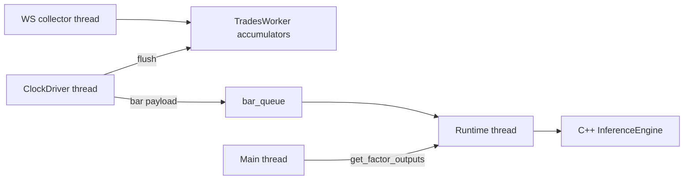
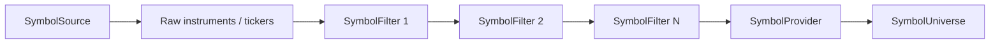
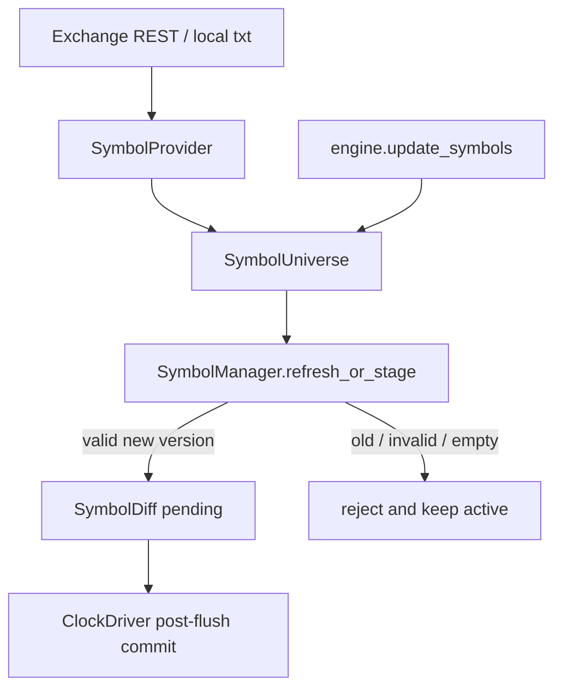
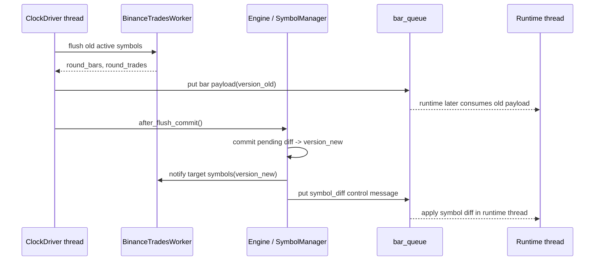
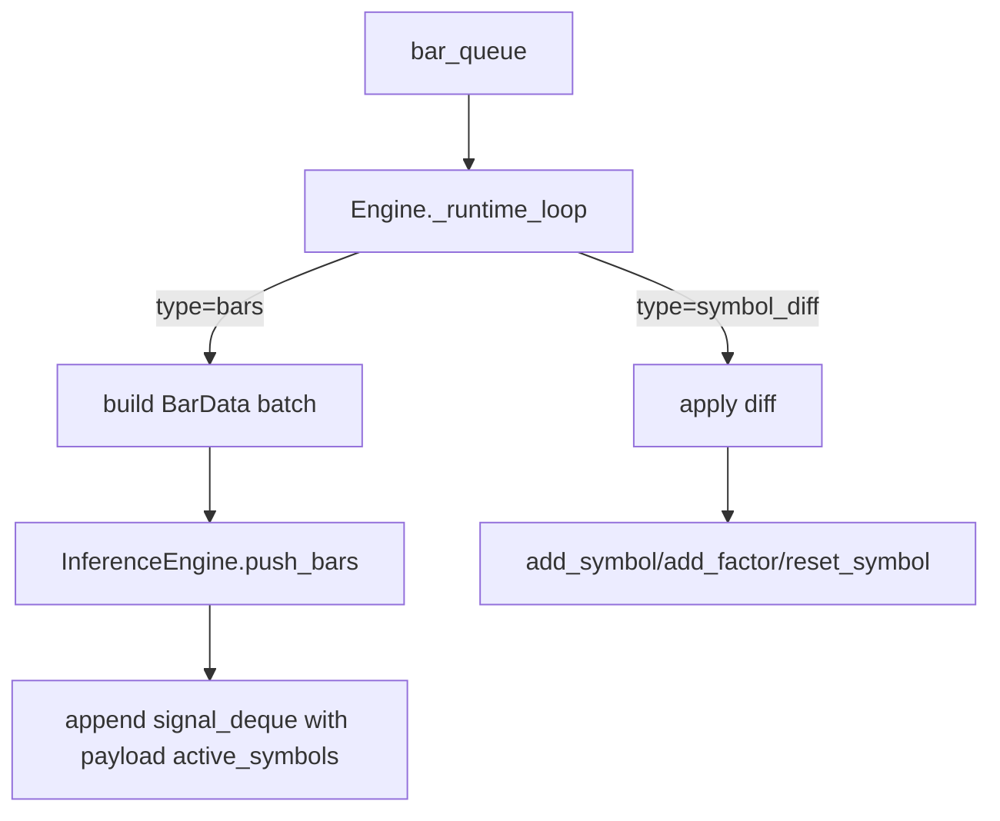
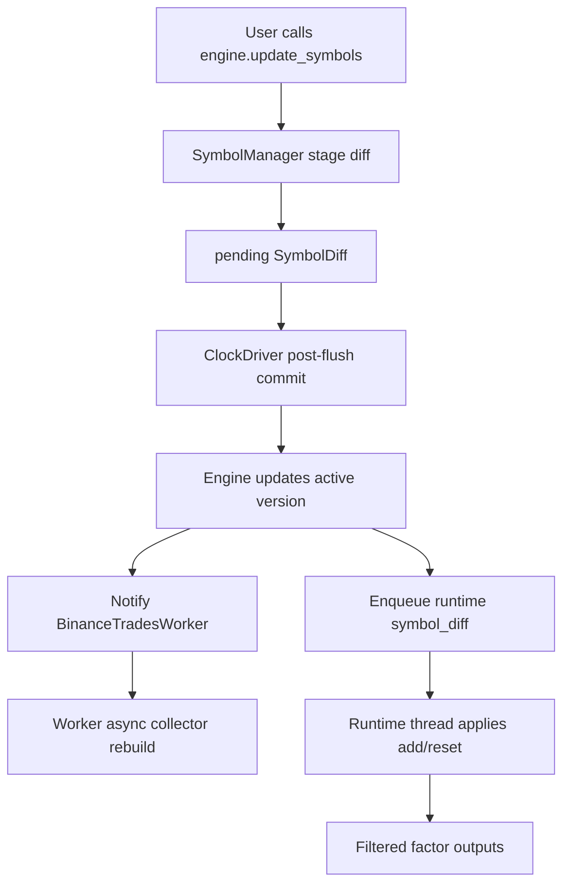
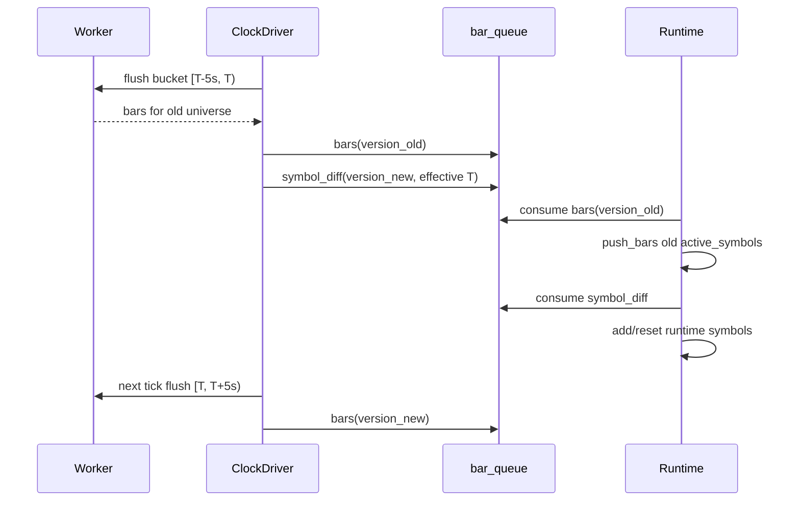
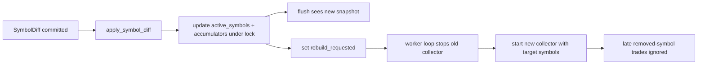

# Dynamic Symbol List Support 开发说明

> 日期：2026-05-24
> 状态：开发设计
> 范围：第一版支持 `exchange="binance"` / `exchange="okx"` + `data_source="trades"` 的低频 symbol universe rebalance，目标是进程不中断

---

## 1. 这次要解决什么

当前 `Engine` 的 `symbols` 在启动时固定：

```python
engine = Engine(
    symbols=["BTC-USDT", "ETH-USDT"],
    exchange="binance",
    data_source="trades",
    factor_group="okx_perp_trades",
)
```

启动后，这个 symbol list 同时绑定了：

1. WebSocket collector 的订阅列表。
2. `TradesAccumulator` / `KlinePublisher` 内部状态。
3. C++ `InferenceEngine` 的 symbol runners。
4. `get_factor_outputs()` 输出集合。
5. audit / verifier 对缺失 bar 的解释。

Dynamic symbol list support 的目标是让 Engine 支持运行中自主 rebalance symbol universe，例如每 30 分钟从 top 200 成交额合约切换到新的 top 200，而不是重启整个进程。

第一版不是高频动态订阅系统。可以把目标理解为：

```text
Dynamic symbol rebalance without process restart
```

而不是：

```text
Real-time dynamic subscription with zero data gap
```

也就是说，我们接受低频切换时 worker 短暂重建连接和新 symbol 自然 warmup，但不接受 Engine 进程退出、ClockDriver 卡死、runtime 并发崩溃或上一根 bucket 被错误丢弃。

第一版只做最小闭环：

```text
Exchange REST / local txt universe
  -> SymbolManager 计算 diff
  -> ClockDriver 在 tick 后提交 diff
  -> BinanceTradesWorker / OKX TradesWorker 切换订阅
  -> runtime thread 顺序 add/reset symbol
  -> outputs 按 payload universe 过滤
```

---

## 2. 为什么不能直接改 `engine.symbols`

动态 symbol 不是一个 list append/remove 问题。现有系统是多线程结构：



如果用户线程或 refresh thread 直接改 `symbols`，会出现几个问题：

1. `flush()` 正在遍历 symbol list 时，另一个线程删除 symbol。
2. collector 还在收到刚删除 symbol 的迟到 trade。
3. ClockDriver 刚 flush 完旧 bucket，runtime thread 还没处理旧 payload。
4. C++ `InferenceEngine.push_bars()` 正在运行时，另一个线程 `add_symbol()`。
5. audit 里缺某个 symbol 时，事后不知道它是 inactive 还是数据缺失。

所以第一版必须明确两个原则：

1. **变更在 ClockDriver tick 边界提交，并且必须发生在当前 bucket flush 之后。**
2. **ClockDriver 只做轻量提交和通知，不直接执行耗时重连或 C++ runtime 结构修改。**

---

## 3. 第一版范围

### 3.1 支持

1. `exchange="binance"` / `exchange="okx"`。
2. `data_source="trades"`。
3. 低频刷新，默认可以按 30 分钟级别执行一次。
4. `BinanceExchangeSymbolSource` 从 Binance 官方 REST 拉可交易 USDT-M 合约。
5. `OkxExchangeSymbolSource` 从 OKX 官方 REST 拉可交易 instruments。
6. `LocalTextSymbolSource` 从人工维护的 txt 文件读取允许交易的 symbol 池。
7. filter pipeline 支持 top-N 24h 成交额、白名单、黑名单等筛选。
8. 手动 `engine.update_symbols([...])`，用于测试或策略侧主动触发。
9. 新增 symbol 创建 accumulator，并在 runtime thread 中创建 C++ runner/factors。
10. 移除 symbol 停止输出、停止订阅，并由 runtime thread 物理删除 C++ runner。
11. re-add symbol 创建 fresh C++ runner 和 fresh factor graphs，避免 rolling window 跨断层复用。
12. payload 带 `symbol_version` / `active_symbols`。
13. 调整期间 Engine 进程不中断，ClockDriver / runtime 继续运行。

### 3.2 暂不支持

1. Binance / OKX kline 或 `kline_trades` 动态 universe。
2. 新 symbol 历史 warmup。
3. 毫秒级无断流订阅切换。
4. WS 内动态 SUBSCRIBE / UNSUBSCRIBE 命令队列。
5. 零数据空窗保证。第一版允许低频 rebalance 时存在短暂 collector 重连窗口。

---

## 4. 新增核心概念

### 4.1 Source / Filter / Provider 分层

第一版不需要 internal HTTP source。我们需要支持的是：

1. 从 Binance / OKX 官方接口拉全市场可交易标的和 24h ticker。
2. 从人工维护的本地 txt 文件读取允许交易的 symbol 池。
3. 对原始 universe 执行 filter，例如只保留 USDT 永续、剔除黑名单、取 24h 成交额 top N。

因此建议把概念拆成三层：

```text
SymbolSource
  -> 负责“从哪里拿原始候选 symbol / metadata”

SymbolFilter
  -> 负责“怎么过滤、排序、截断”

SymbolProvider
  -> 组合 source + filters，最终产出 SymbolUniverse
```

流程：



### 4.2 SymbolSource

`SymbolSource` 只负责拿原始候选，不负责改 Engine。

```python
class SymbolSource:
    def fetch(self) -> SymbolSourceSnapshot:
        ...
```

建议第一版实现：

| Source | 用途 |
|--------|------|
| `BinanceExchangeSymbolSource` | 从 Binance 官方 REST 拉 USDT-M 合约列表和 24h ticker |
| `OkxExchangeSymbolSource` | 从 OKX 官方 REST 拉 instruments，支持 OKX trades 动态 universe |
| `LocalTextSymbolSource` | 从人工维护的 txt 文件读取允许交易 symbol 池 |
| `StaticSymbolSource` | 测试用，直接从 list 构造 |

不做：

| Source | 原因 |
|--------|------|
| `InternalHttpSymbolSource` | 当前没有内部 symbol-service，暂不设计为第一版依赖 |

### 4.3 本地 txt 文件格式

人工维护 symbol 池可以先用最简单的一列一 symbol：

```text
# config/symbol_pools/binance_usdt_perp.txt
# lines starting with # are comments
BTC-USDT
ETH-USDT
SOL-USDT
BNB-USDT
DOGE-USDT
```

读取规则：

1. 空行忽略。
2. `#` 开头忽略。
3. symbol 统一 normalize 成内部格式，例如 `BTC-USDT`。
4. 重复 symbol 去重。
5. 文件不存在或读失败时，不清空当前 active universe，而是记录 provider error。

这个 txt 文件可以作为“人工允许池”。例如先从 Binance 官方 REST 拉全市场，再和 txt 文件取交集，只在人工允许池里做 top-N。

### 4.4 SymbolFilter

`SymbolFilter` 负责把 raw candidates 变成目标候选集合。

```python
class SymbolFilter:
    def apply(self, snapshot: SymbolSourceSnapshot) -> SymbolSourceSnapshot:
        ...
```

第一版建议支持：

| Filter | 作用 |
|--------|------|
| `QuoteAssetFilter("USDT")` | 只保留 USDT 计价 |
| `ContractTypeFilter("PERPETUAL")` | 只保留永续合约 |
| `TradableStatusFilter()` | 只保留交易中标的 |
| `AllowListFilter(symbols)` | 只保留人工 txt 池里的 symbol |
| `DenyListFilter(symbols)` | 剔除黑名单 |
| `TopQuoteVolumeFilter(top_n=200)` | 按 24h quote volume 排序取 top N |

示例：从 Binance 官方 REST 拉全市场，再取人工允许池中的成交额 top 200：

```python
provider = SymbolProvider(
    source=BinanceExchangeSymbolSource(),
    filters=[
        QuoteAssetFilter("USDT"),
        ContractTypeFilter("PERPETUAL"),
        TradableStatusFilter(),
        AllowListFilter.from_txt("config/symbol_pools/binance_usdt_perp.txt"),
        TopQuoteVolumeFilter(top_n=200),
    ],
    refresh_interval_seconds=1800,
)
```

示例：只用人工 txt 文件作为 universe：

```python
provider = SymbolProvider(
    source=LocalTextSymbolSource("config/symbol_pools/binance_usdt_perp.txt"),
    filters=[
        DenyListFilter(["BAD-USDT"]),
    ],
    refresh_interval_seconds=1800,
)
```

### 4.5 SymbolProvider

`SymbolProvider` 是 source + filters 的编排器。它输出的仍然是全量目标 universe。

```python
class SymbolProvider:
    def fetch(self) -> SymbolUniverse:
        snapshot = self.source.fetch()
        for f in self.filters:
            snapshot = f.apply(snapshot)
        return SymbolUniverse(
            version=snapshot.version,
            exchange=snapshot.exchange,
            symbols=tuple(snapshot.symbols),
            ttl_seconds=self.ttl_seconds,
            metadata=snapshot.metadata,
        )
```

注意：即使 provider 从交易所官方接口拉到了全市场，它也不直接覆盖 `engine.symbols`。它只是产出 `SymbolUniverse`，后续仍然走 `SymbolManager -> pending diff -> ClockDriver post-flush commit`。

### 4.6 SymbolUniverse

上游传入的是全量目标列表，而不是增量事件。

```python
@dataclass(frozen=True)
class SymbolUniverse:
    version: str
    exchange: str
    symbols: tuple[str, ...]
    ttl_seconds: int | None = None
    metadata: dict | None = None
```

示例：

```json
{
  "version": "2026-05-24T12:00:00.000Z",
  "exchange": "binance",
  "symbols": ["BTC-USDT", "ETH-USDT", "SOL-USDT"],
  "ttl_seconds": 30,
  "metadata": {"source": "top_turnover", "limit": 200}
}
```

### 4.7 SymbolDiff

`SymbolManager` 根据当前 active set 和目标 universe 计算 diff。

```python
@dataclass(frozen=True)
class SymbolDiff:
    version: str
    added: frozenset[str]
    removed: frozenset[str]
    unchanged: frozenset[str]
    target: frozenset[str]
    reason: str | None = None
```

### 4.8 SymbolManager

职责：

1. 校验 exchange。
2. 规范化 symbol 格式。
3. 去重、排序。
4. 拒绝旧 version。
5. 拒绝默认空 universe。
6. 控制单次大规模变更。
7. 把 diff stage 到 pending。
8. 等待 ClockDriver tick 后 commit。



---

## 5. Tick 边界提交流程

核心时序：

```text
tick T:
  1. workers.flush()
  2. ClockDriver._aggregate()
  3. audit.write_aggregate_batch()
  4. bar_queue.put(bar payload for [T-freq, T))
  5. after_flush_commit()
       - commit pending SymbolDiff
       - update Engine active_symbols/version
       - notify worker target symbols
       - enqueue runtime symbol_diff control message

tick T+freq:
  workers.flush() now reflects new target universe
```

流程图：



为什么必须 post-flush：

1. `flush()` 收集的是刚刚结束的上一根 bucket。
2. 如果先 remove symbol，再 flush，会丢掉上一根 bucket 已经累计好的 trades。
3. post-flush commit 让 diff 从下一根 bucket 生效，语义清晰。

---

## 6. Runtime control message

当前 `_runtime_loop()` 只处理两类 legacy payload：

```python
(round_bars, round_trades)
round_bars
```

动态 universe 后建议引入结构化 payload：

```python
{
    "type": "bars",
    "bars": merged_bars,
    "trades": merged_trades,
    "bucket_ts_ms": bucket_ts_ms,
    "symbol_version": "2026-05-24T12:00:00.000Z",
    "active_symbols": {"BTC-USDT", "ETH-USDT"},
}
```

symbol diff 作为 control message 进入同一条队列：

```python
{
    "type": "symbol_diff",
    "diff": diff,
    "effective_from_ts_ms": next_bucket_ts_ms,
}
```

顺序必须是：

```text
bars(version_old, bucket [T-freq, T))
symbol_diff(version_new, effective from T)
bars(version_new, bucket [T, T+freq))
```

这样 C++ runtime 的结构修改只发生在 runtime thread 内：



这个设计避免了 ClockDriver 线程在 `push_bars()` 并发期间直接调用 `add_symbol()`。

---

## 7. Engine 改造点

### 7.1 初始化

`Engine.__init__` 保持向后兼容：

```python
Engine(symbols=["BTC-USDT", "ETH-USDT"], ...)
```

内部可等价为：

```python
symbol_provider = SymbolProvider(
    source=StaticSymbolSource(symbols),
    filters=[],
)
symbol_manager = SymbolManager(
    initial_symbols=symbols,
    exchange=exchange,
)
```

新增参数建议：

```python
symbol_provider: SymbolProvider | None = None
allow_dynamic_symbols: bool = False
```

第一版也可以先不暴露 provider，只提供：

```python
engine.update_symbols(["BTC-USDT", "ETH-USDT", "SOL-USDT"])
```

更完整的自动刷新用法：

```python
engine = Engine(
    exchange="binance",
    data_source="trades",
    data_freq="5s",
    factor_group="okx_perp_trades",
    symbol_provider=SymbolProvider(
        source=BinanceExchangeSymbolSource(),
        filters=[
            QuoteAssetFilter("USDT"),
            ContractTypeFilter("PERPETUAL"),
            TradableStatusFilter(),
            AllowListFilter.from_txt("config/symbol_pools/binance_usdt_perp.txt"),
            TopQuoteVolumeFilter(top_n=200),
        ],
        refresh_interval_seconds=1800,
    ),
)
```

这里的 txt 文件是人工维护的可交易池；交易所 REST 提供实时可交易状态和 24h 成交额；filter pipeline 负责取交集和 top-N。默认刷新周期可以按 30 分钟级别配置，第一版不需要 30 秒级高频刷新。

### 7.2 手动更新

`update_symbols()` 只 stage diff，不立即修改 worker/runtime。

```python
def update_symbols(self, symbols: list[str], *, version: str | None = None) -> SymbolDiff | None:
    universe = SymbolUniverse(
        version=version or now_version(),
        exchange=self._exchange,
        symbols=tuple(symbols),
    )
    diff = self._symbol_manager.stage_universe(universe)
    return diff
```

### 7.3 post-flush commit hook

Engine 提供给 ClockDriver：

```python
def commit_pending_symbol_diff(self, *, effective_from_ts_ms: int) -> None:
    diff = self._symbol_manager.commit_pending()
    if diff is None:
        return

    self._active_symbols = set(diff.target)
    self._symbol_version = diff.version
    self._trades_worker.apply_symbol_diff(diff)
    self._bar_queue.put({
        "type": "symbol_diff",
        "diff": diff,
        "effective_from_ts_ms": effective_from_ts_ms,
    })
```

注意：这里 `apply_symbol_diff()` 不能阻塞等待 collector 完整重连；它只做轻量通知。

---

## 8. ClockDriver 改造点

新增参数：

```python
after_flush_commit: Callable[[int], None] | None = None
```

`_flush_and_aggregate()` 的顺序：

```python
merged_bars, merged_trades = self._aggregate(raw)

if merged_bars:
    self._audit.write_aggregate_batch(...)
    self._bar_queue.put(payload, block=False)

if self._after_flush_commit is not None:
    self._after_flush_commit(next_bucket_ts_ms)
```

其中 `next_bucket_ts_ms` 就是当前 tick 边界，也就是刚刚 flush 的 bucket 结束时间、新 universe 的生效时间。

约束：

1. hook 必须短。
2. hook 不做网络请求。
3. hook 不等待 worker join。
4. hook 不直接调用 C++ `InferenceEngine`。

---

## 9. BinanceTradesWorker 改造点

### 9.1 现状

当前 worker 核心状态：

```python
self.symbols = list(symbols)
self._accumulators = {sym: TradesAccumulator() for sym in self.symbols}
self._collector = BinanceTradesCollector(symbols=self.symbols, ...)
```

`flush()` 遍历 `self.symbols`：

```python
for sym in self.symbols:
    snap = self._accumulators[sym].snapshot_and_reset()
```

动态后必须加锁，否则 `flush()` 和 `apply_symbol_diff()` 可能并发读写。

### 9.2 新状态

建议：

```python
self._symbol_lock = threading.RLock()
self._active_symbols: set[str] = set(symbols)
self._target_symbols: set[str] = set(symbols)
self._accumulators: dict[str, TradesAccumulator] = {...}
self._rebuild_requested = threading.Event()
```

### 9.3 apply_symbol_diff

```python
def apply_symbol_diff(self, diff: SymbolDiff) -> None:
    with self._symbol_lock:
        for sym in diff.added:
            self._accumulators[sym] = TradesAccumulator()
        for sym in diff.removed:
            self._accumulators.pop(sym, None)
        self._active_symbols = set(diff.target)
        self._target_symbols = set(diff.target)
        self.symbols = sorted(diff.target)
    self._request_collector_rebuild()
```

`flush()`：

```python
with self._symbol_lock:
    symbols = list(self._active_symbols)
    accumulators = {sym: self._accumulators.get(sym) for sym in symbols}

for sym, acc in accumulators.items():
    if acc is None:
        continue
    snap = acc.snapshot_and_reset()
```

`_on_trade()`：

```python
with self._symbol_lock:
    acc = self._accumulators.get(symbol)
if acc is None:
    return
acc.update(px, sz, side)
```

迟到消息会被自然忽略。

### 9.4 Collector 重建

第一版不做 WS 内动态 subscribe/unsubscribe，而是重建连接。

这个选择和“低频 universe rebalance”目标匹配：如果 symbol list 半小时左右才调整一次，重建连接带来的短暂断流是可以接受的，换来的是实现简单、状态边界清晰、reconnect 后订阅集合确定。

不要在 ClockDriver 线程里同步执行：

```text
stop old collector -> join worker -> start new collector
```

建议 worker 自己线程处理 rebuild request：

```mermaid
sequenceDiagram
    participant CD as ClockDriver
    participant W as BinanceTradesWorker
    participant LOOP as Worker asyncio thread
    participant WS as Binance WS

    CD->>W: apply_symbol_diff(diff)
    W->>W: update target symbols, set rebuild flag
    LOOP->>WS: stop current collector at safe point
    LOOP->>W: read target symbols snapshot
    LOOP->>WS: create new collector and subscribe
```

这样即使重建连接耗时，也不会卡住 ClockDriver tick。

重建期间的期望行为：

1. Engine 进程继续运行。
2. ClockDriver 不因等待重连而卡死。
3. runtime thread 继续处理已经入队的 payload / control message。
4. 新连接建立后，worker 使用最新 target symbols 继续累计 trades。
5. audit universe event 记录这次 rebalance，便于解释切换窗口。

---

## 10. Runtime add/reset symbol

### 10.1 新增 symbol

runtime thread 收到 `symbol_diff` 后：

```python
for sym in diff.added:
    if sym not in self._runtime_symbols:
        self._inference.add_symbol(sym)
        for group in self._factor_groups:
            graphs = reg.build_group(group)
            for fid, graph in graphs.items():
                self._inference.add_factor(sym, fid, graph)
```

### 10.2 移除 symbol

runtime thread 消费 `symbol_diff` 后，物理删除 C++ runner：

```python
for sym in diff.removed:
    if self._inference.has_symbol(sym):
        self._inference.remove_symbol(sym)
```

这样 C++ registered universe 和 active universe 收敛，长期低频轮换不会留下 retained inactive runner。

### 10.3 re-add symbol

re-add symbol 不复用旧 state，而是作为 fresh symbol 重新创建：

```python
for sym in diff.added:
    if self._inference.has_symbol(sym):
        self._inference.remove_symbol(sym)
    self._add_runtime_symbol_with_factors(sym)
```

原因：symbol 移除期间没有持续推 bars，旧 rolling window 有时间断层。re-add 时复用旧 state 会让因子值看起来连续，但实际数据缺失。

---

## 11. 输出过滤

`signal_deque` 里的每条输出要保留 payload 对应的 universe：

```python
self._signal_deque.append({
    "ts": ts_ms,
    "bar_index": self._bars_pushed,
    "symbol_version": payload_symbol_version,
    "active_symbols": payload_active_symbols,
    "factors": filtered_result,
})
```

`get_factor_outputs()` 默认返回最新 payload 的 active set，而不是当前 Engine active set。

原因：runtime thread 可能滞后，如果用当前 active set 过滤旧 payload，会把旧 bucket 的输出误过滤。

---

## 12. Audit 改造

动态 universe 后，audit 需要能回答：

```text
某一分钟某个 symbol 没有 audit bar，是数据缺失，还是当时不在 universe？
```

### 12.1 AggregateBarEvent 增加版本

```python
symbol_version: str | None
```

可选：

```python
universe_reason: str | None
```

### 12.2 Universe change event

建议新增事件：

```json
{
  "event_ts_ms": 1790000001000,
  "effective_from_ts_ms": 1790000005000,
  "exchange": "binance",
  "data_source": "trades",
  "version": "2026-05-24T12:00:00.000Z",
  "active_count": 200,
  "added": ["SOL-USDT"],
  "removed": ["DOGE-USDT"],
  "target_symbols": ["BTC-USDT", "ETH-USDT", "SOL-USDT"],
  "reason": "top_volume_200"
}
```

第一版可以先把 event 复用 `AuditWriter` 队列和 rotate 策略，但建议文件名区分：

```text
symbol_universe_events_YYYYMMDD_HHMMSS_part000001.jsonl
```

---

## 13. 端到端流程图

### 13.1 手动更新流程



### 13.2 Tick 与 payload 顺序



### 13.3 Worker 重建流程



---

## 14. 实施顺序

### Phase 1：fake 闭环

先不接真实 Binance WS。

目标：

1. 新增 `SymbolUniverse` / `SymbolDiff` / `SymbolManager`。
2. 新增 `StaticSymbolSource` / `LocalTextSymbolSource` 和基础 filter 接口。
3. `ClockDriver` 支持 `after_flush_commit` hook。
4. bar payload 支持结构化 dict，同时保持 legacy tuple 兼容。
5. runtime loop 支持 `symbol_diff` control message。
6. fake worker 验证 post-flush commit 不丢上一根 bucket。

测试：

```bash
pytest tests/dataflow/test_clock_driver.py -v
pytest tests/runtime_engine/test_engine_dynamic_symbols.py -v
```

### Phase 2：Binance trades worker

目标：

1. `BinanceTradesWorker.apply_symbol_diff()`。
2. `flush()` 使用 active symbols 快照。
3. `_on_trade()` 容忍 removed symbol。
4. collector 重建异步化，不阻塞 ClockDriver。

测试：

```bash
pytest tests/dataflow/binance/test_binance_trades_worker.py -v
pytest tests/dataflow/test_okx_trades_worker_dynamic.py -v
```

### Phase 3：Exchange source + filter pipeline

目标：

1. `BinanceExchangeSymbolSource` 拉 Binance 官方 `exchangeInfo` 和 `ticker/24hr`。
2. `OkxExchangeSymbolSource` 实现 instruments 获取，供 OKX trades 动态 universe 使用。
3. `AllowListFilter.from_txt(...)` 支持人工维护池。
4. `TopQuoteVolumeFilter(top_n=...)` 支持 24h quote volume 排序截断。
5. source/filter 只产出 `SymbolUniverse`，不直接改 Engine。

测试：

```bash
pytest tests/symbols/ -v
```

### Phase 4：Engine 集成

目标：

1. `Engine.update_symbols()`。
2. `Engine.active_symbols` / `symbol_version` / `pending_symbol_diff`。
3. `_runtime_loop()` 处理结构化 bars payload 和 symbol diff。
4. `get_factor_outputs()` 按 payload active symbols 过滤。
5. 可选 symbol refresh thread 以低频周期调用 `symbol_provider.fetch()`，默认可按 1800 秒执行，并把结果 stage 到 `SymbolManager`。

测试：

```bash
pytest tests/runtime_engine/test_engine_dynamic_symbols.py -v
pytest tests/dataflow/binance/test_engine_binance.py -v
```

### Phase 5：Audit / verifier

目标：

1. Aggregate bar 写 `symbol_version`。
2. Audit writer 写 universe change events。
3. verifier 根据 universe events 判断 missing 是否真实异常。

测试：

```bash
pytest tests/audit/ -v
```

---

## 15. 关键测试用例

### 15.1 本地 txt 人工池读取

输入文件：

```text
# comment
BTC-USDT
ETH-USDT

SOL-USDT
BTC-USDT
```

期望：

1. 忽略注释和空行。
2. 去重。
3. 输出 `BTC-USDT` / `ETH-USDT` / `SOL-USDT`。
4. 文件读取失败不清空当前 active universe，只记录 provider error。

### 15.2 Exchange REST source + top volume filter

使用 fake Binance REST 响应：

```text
exchangeInfo:
  BTCUSDT PERPETUAL TRADING
  ETHUSDT PERPETUAL TRADING
  OLDUSDT PERPETUAL BREAK

ticker/24hr:
  BTCUSDT quoteVolume=100
  ETHUSDT quoteVolume=200
```

期望：

1. `TradableStatusFilter` 剔除非 trading symbol。
2. `QuoteAssetFilter("USDT")` 只保留 USDT。
3. `TopQuoteVolumeFilter(top_n=1)` 选择 `ETH-USDT`。

### 15.3 AllowListFilter 与交易所全集取交集

人工 txt：

```text
BTC-USDT
SOL-USDT
```

交易所可交易：

```text
BTC-USDT
ETH-USDT
```

期望：

```text
final symbols = {BTC-USDT}
```

`SOL-USDT` 因为交易所不可交易被剔除，`ETH-USDT` 因为不在人工允许池被剔除。

### 15.4 post-flush commit 不丢 bucket

场景：

```text
active = {BTC, ETH}
pending remove ETH
tick T arrives
ETH accumulator has trades in [T-5s, T)
```

期望：

1. tick T 的 payload 仍包含 ETH。
2. diff 在 payload 后提交。
3. tick T+5s 起 ETH 不再出现在 worker flush。

### 15.5 runtime control message 顺序

队列顺序：

```text
bars(version_1)
symbol_diff(version_2 add SOL)
bars(version_2)
```

期望：

1. 第一条 bars 不包含 SOL。
2. runtime 处理 diff 后 add SOL runner。
3. 第二条 bars 可以 push SOL。

### 15.6 removed symbol 迟到 trade

场景：

1. Remove `DOGE-USDT`。
2. collector 旧连接还收到一条 `DOGE-USDT` trade。

期望：

1. `_on_trade()` 不抛异常。
2. 不创建新的 accumulator。
3. 下一次 `flush()` 不返回 DOGE。

### 15.7 re-add reset

场景：

1. `SOL-USDT` 运行 200 bars。
2. remove SOL。
3. 等待 50 bars。
4. re-add SOL。

期望：

1. SOL 的 runtime state 从 fresh runner 重新 warmup。
2. 输出不会复用 remove 前 rolling window。

---

## 16. 风险和降级

### 16.1 Source / Provider 失败

行为：

1. 保留当前 active universe。
2. `provider_errors += 1` 或 `source_errors += 1`。
3. 超过 TTL 后告警。
4. 不自动清空 symbols。

### 16.2 空 universe

默认拒绝：

```python
allow_empty = False
```

除非上游显式允许，否则空 list 视为异常响应。

### 16.3 大规模变更

建议限制：

```python
max_change_ratio = 0.5
max_added_per_commit = 50
max_removed_per_commit = 50
```

超过阈值可拒绝或拆分提交。

### 16.4 Collector 重建断流

第一版接受低频 rebalance 时的短暂断流。原因是目标是 correctness 和 process continuity，不是毫秒级切换或 zero-gap subscription。

后续如果断流不可接受，再升级到 WS 内动态 SUBSCRIBE / UNSUBSCRIBE。

---

## 17. 开发 checklist

1. 新增 `dataflow/symbols/` 或 `factorengine/symbols/` 放 `SymbolUniverse` / `SymbolDiff` / `SymbolManager`。
2. 新增 `SymbolSource` / `SymbolFilter` / `SymbolProvider` 抽象。
3. 实现 `StaticSymbolSource` / `LocalTextSymbolSource`。
4. 实现 `BinanceExchangeSymbolSource`，拉官方 `exchangeInfo` 和 `ticker/24hr`。
5. 实现 `OkxExchangeSymbolSource`，完成官方 REST 获取和 normalize。
6. 实现 `AllowListFilter.from_txt(...)` / `DenyListFilter` / `TopQuoteVolumeFilter`。
7. `ClockDriver` 增加 `after_flush_commit` hook。
8. `ClockDriver` bar payload 支持结构化 dict，并保留 legacy tuple 兼容。
9. `Engine._runtime_loop()` 支持 `type="bars"` / `type="symbol_diff"`。
10. `Engine.update_symbols()` 只 stage diff。
11. `Engine.commit_pending_symbol_diff()` 只做轻量通知。
12. 可选 symbol refresh thread 以低频周期调用 `symbol_provider.fetch()`，默认 1800 秒级别。
13. `BinanceTradesWorker` / OKX `TradesWorker` 加 symbol lock 和 active snapshot flush。
14. `BinanceTradesWorker` / OKX `TradesWorker` 支持异步 collector rebuild。
15. C++ / pybind 增加 `has_symbol()` / `reset_symbol()` / `remove_symbol()`，runtime thread 对 removed symbols 物理删除 runner。
16. `signal_deque` 记录 `symbol_version` / `active_symbols`。
17. audit 增加 `symbol_version` 和 universe change event。
18. verifier 支持 universe events 后再判断 missing。

---

## 18. 一句话结论

Dynamic symbol list support 的核心不是让 `symbols` 可变，而是建立一条可审计、可顺序化、线程所有权清晰的低频 rebalance 控制流：**上游 universe 先变成 pending diff，ClockDriver 在 post-flush 边界提交版本，worker 异步重建订阅但不停止进程，runtime thread 顺序 add/reset symbol，outputs 和 audit 都携带当时的 universe version**。第一版覆盖 Binance / OKX trades，可以把风险控制在最短的数据链路里。
