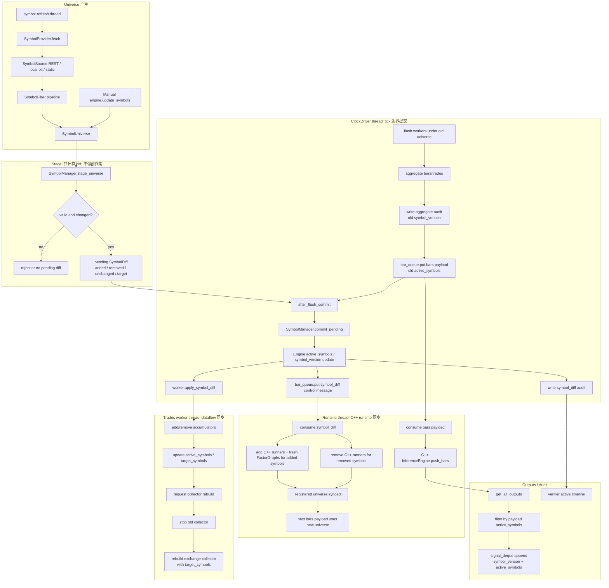
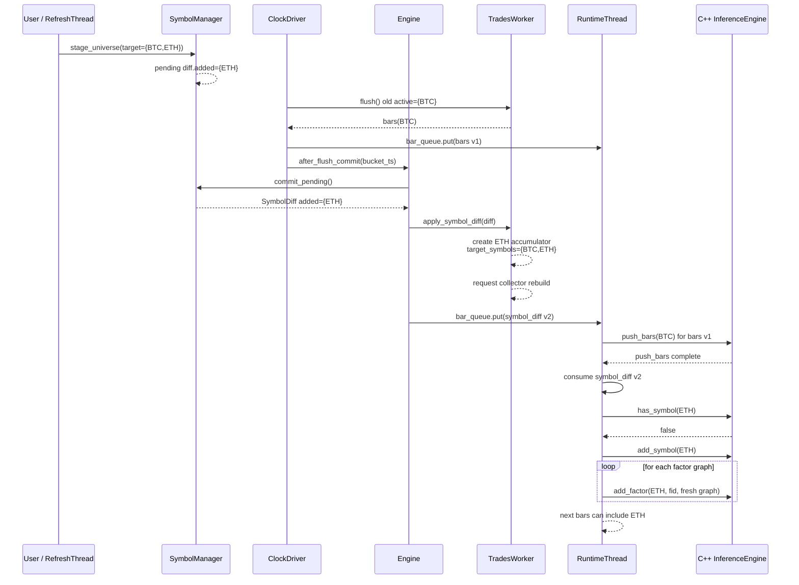
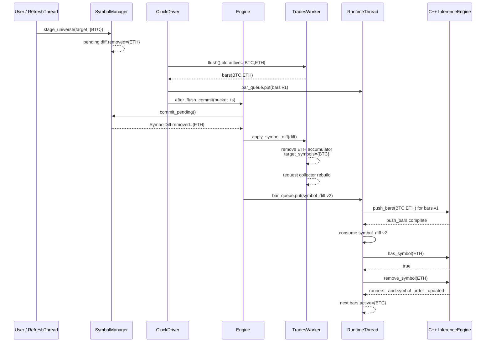

# Dynamic Symbol End-to-End Flow 说明

> 日期：2026-05-25
> 状态：实现细节说明
> 范围：解释当前 dynamic symbol list 如何从 dataflow 层一路同步到 C++ runtime，包括 add / remove / re-add symbol 的完整过程

---

## 1. 这份文档解决什么问题

前面的文档分别描述了：

1. `docs/20260524/dynamic_symbol_list_support_development.md`
   - 设计 dynamic symbol universe 的整体控制流。
   - 解释 `SymbolSource` / `SymbolFilter` / `SymbolProvider` / `SymbolManager`。
   - 解释 ClockDriver post-flush commit。

2. `docs/20260525/cpp_runtime_dynamic_symbol_support_development.md`
   - 解释为什么只改 dataflow 不够。
   - 解释 C++ `InferenceEngine` 需要真实 add/remove `SymbolRunner`。

这份文档把两边合起来，按当前代码说明：

```text
上层 dataflow dynamic universe
  如何触发 symbol diff
  如何让 worker 重建订阅
  如何保证当前 bucket 不丢

下层 C++ runtime
  如何物理 add/remove SymbolRunner
  如何为新增 symbol 挂 fresh FactorGraph
  如何避免 re-add 复用旧 rolling state
```

---

## 2. 当前 end-to-end 目标语义

当前目标已经不是 retained inactive，而是彻底同步：

```text
add symbol
  -> worker 创建 accumulator
  -> WS collector rebuild 后订阅新 symbol
  -> C++ InferenceEngine add_symbol
  -> 为该 symbol add fresh factor graphs
  -> 后续 bars 开始进入 C++ push_bars

remove symbol
  -> worker 删除 accumulator
  -> WS collector rebuild 后停止订阅该 symbol
  -> C++ InferenceEngine remove_symbol
  -> Python output 不再暴露该 symbol
  -> audit 记录 symbol_diff

re-add symbol
  -> 因为之前 C++ runner 已被 remove
  -> 重新 add_symbol + fresh factor graphs
  -> rolling state 从 0 开始 warm up
```

也就是说，下面几层最终会收敛到同一个 active universe：

```text
SymbolManager active universe
Engine.symbols / active_symbols
TradesWorker active_symbols / target_symbols
WebSocket collector subscribed symbols
C++ InferenceEngine.symbols()
signal_deque[-1]["factors"].keys()
audit symbol_version / symbol_diff
```

---

## 3. 完整流程图

### 3.1 总览：从 universe refresh 到 C++ runtime 同步



这张图里最重要的是两个顺序：

```text
ClockDriver thread:
  bars payload 先入队
  symbol_diff 后入队

Runtime thread:
  push_bars 先完成
  C++ add/remove runner 后发生
```

### 3.2 Add symbol 时序图



### 3.3 Remove symbol 时序图



### 3.4 Runtime thread 顺序保证

```mermaid
flowchart LR
    Q1[bar_queue: bars v1] --> R1[RuntimeThread handles bars v1]
    R1 --> P1[C++ push_bars starts]
    P1 --> TP[C++ thread pool computes symbols in parallel]
    TP --> P2[push_bars waits for all tasks]
    P2 --> R2[push_bars returns]
    R2 --> Q2[bar_queue: symbol_diff v2]
    Q2 --> R3[RuntimeThread handles symbol_diff]
    R3 --> M1[C++ remove_symbol / add_symbol]
    M1 --> Q3[bar_queue: bars v2]
    Q3 --> R4[RuntimeThread handles bars v2]
```



这里没有并发删除 runner 的风险，因为 `symbol_diff` 一定在 `push_bars()` 返回后才会被 runtime thread 处理。

---

## 4. 核心线程和职责

| 线程 / 组件 | 负责什么 | 不负责什么 |
|-------------|----------|------------|
| User / strategy thread | 调 `engine.update_symbols(...)` 或读 outputs | 不直接改 worker / C++ |
| symbol-refresh thread | 低频调用 `symbol_provider.fetch()` 并 stage universe | 不 commit、不碰 worker、不碰 C++ |
| SymbolManager | 校验 universe、计算 diff、暂存 pending diff | 不做 side effect |
| ClockDriver thread | flush 当前 bucket，post-flush commit pending diff，enqueue control message | 不重连 WS、不改 C++ |
| trades worker thread | 重建 exchange collector，维护 accumulators | 不碰 bar_queue、不碰 C++ |
| factor runtime thread | 顺序消费 `bars` / `symbol_diff`，调用 C++ add/remove/push | 不拉 REST、不重连 WS |
| C++ thread pool | 并行执行当前 `push_bars()` 内各 symbol 的 factor graph 计算 | 不做 universe mutation |

关键原则：

```text
ClockDriver 只负责“何时提交 diff”
runtime thread 负责“何时修改 C++ runtime”
worker thread 负责“何时重建 WS collector”
```

---

## 5. 静态启动时 C++ runtime 怎么建

启动时如果配置了 `factor_group`，Engine 会初始化 C++ `InferenceEngine`。

当前代码路径在 `factorengine/engine.py`：

```python
def _init_inference(self, groups: list[str], num_threads: int):
    import fe_runtime as rt
    from factorengine.factors import FactorRegistry

    reg = FactorRegistry()
    for group in groups:
        reg.load_group(group)

    self._factor_registry = reg
    self._inference = rt.InferenceEngine(num_threads=num_threads)
    for sym in self.symbols:
        self._add_runtime_symbol_with_factors(sym)
```

实际每个 symbol 的 C++ runner 创建由 helper 完成：

```python
def _add_runtime_symbol_with_factors(self, symbol: str) -> None:
    if self._inference is None or self._factor_registry is None:
        return
    if hasattr(self._inference, "has_symbol") and self._inference.has_symbol(symbol):
        raise RuntimeError(f"Runtime symbol already registered: {symbol}")

    self._inference.add_symbol(symbol)
    for group in self._factor_groups:
        graphs = self._factor_registry.build_group(group)
        for fid, graph in graphs.items():
            self._inference.add_factor(symbol, fid, graph)
```

这里有两个重要点：

1. 每个 symbol 都会有独立 `SymbolRunner`。
2. 每个 symbol 都会重新 `build_group(group)`，拿到 fresh `FactorGraph`。

不能把同一套 `FactorGraph` 复用到多个 symbol，因为每个 `FactorGraph` 内部都有自己的 rolling state。

---

## 6. Universe 从哪里来

dynamic universe 有两种入口。

### 6.1 手动入口

用户或策略侧直接调用：

```python
engine.update_symbols(["BTC-USDT", "ETH-USDT", "SOL-USDT"], version="manual:v2")
```

`Engine.update_symbols()` 只是 stage：

```python
return self._symbol_manager.update_symbols(
    symbols,
    version=version,
    metadata=metadata,
    allow_empty=allow_empty,
)
```

### 6.2 provider refresh 入口

如果配置了 `symbol_provider`，Engine start 后会启动 `symbol-refresh` 线程。

refresh thread 做：

```python
universe = self._symbol_provider.fetch()
return self._symbol_manager.stage_universe(universe)
```

它只 stage universe，不直接 commit。

这很重要：REST 拉取和 filter pipeline 可以发生在 refresh thread，但真正生效必须等 ClockDriver tick 边界。

---

## 7. SymbolManager 如何算 diff

`SymbolManager.stage_universe()` 输入的是一个完整目标 universe：

```text
current active = {BTC, ETH}
target universe = {BTC, SOL}
```

它计算：

```text
added     = target - active    = {SOL}
removed   = active - target    = {ETH}
unchanged = active & target    = {BTC}
target    = {BTC, SOL}
```

然后保存成 pending diff：

```python
self._pending = SymbolDiff(
    version=universe.version,
    added=frozenset(added),
    removed=frozenset(removed),
    unchanged=frozenset(unchanged),
    target=frozenset(target),
)
```

此时还没有任何 worker 或 C++ runtime 被修改。

---

## 8. 为什么要 post-flush commit

假设当前 active universe 是：

```text
v1 = {BTC, ETH}
```

refresh thread stage 了：

```text
v2 = {BTC, SOL}
```

如果立刻改 worker / C++，可能发生：

1. ClockDriver 正在 flush `ETH` 的最后一根 bucket。
2. worker 突然删除 `ETH` accumulator。
3. runtime 还没处理旧 bars payload。
4. C++ runner 被提前删除。

所以当前实现固定在 ClockDriver 里按顺序做：

```python
merged_bars, merged_trades = self._aggregate(raw)

# 1. 先写旧 universe 的 audit
self._audit.write_aggregate_batch(...)

# 2. 先把旧 universe 的 bars payload 放入 bar_queue
self._bar_queue.put(payload)

# 3. 再 commit pending symbol diff
self._after_flush_commit(bucket_ts_ms)
```

顺序是：

```text
flush old bucket
  -> enqueue bars(v1)
  -> commit diff(v2)
  -> enqueue symbol_diff(v2)
```

runtime thread 看到的顺序就是：

```text
bars(v1)
symbol_diff(v2)
bars(v2)
```

这保证了旧 bucket 不会因为 universe 切换而丢失。

---

## 9. Commit 时 Python dataflow 层做什么

ClockDriver post-flush 调用：

```python
Engine.commit_pending_symbol_diff(bucket_ts_ms)
```

Engine 做几件事：

```python
diff = self._symbol_manager.commit_pending()

self._active_symbols = set(diff.target)
self._symbol_version = diff.version
self.symbols = sorted(diff.target)
```

然后通知 trades worker：

```python
if self._trades_worker is not None and hasattr(self._trades_worker, "apply_symbol_diff"):
    self._trades_worker.apply_symbol_diff(diff)
```

然后写 audit：

```python
self._write_symbol_diff_audit(diff, effective_from_ts_ms)
```

最后给 runtime thread 发 control message：

```python
self._bar_queue.put({
    "type": "symbol_diff",
    "diff": diff,
    "effective_from_ts_ms": effective_from_ts_ms,
})
```

这一步发生在 ClockDriver thread，但它只做轻量状态更新和消息通知，不做 WebSocket 重连，也不碰 C++ runtime。

---

## 10. Worker 如何处理 add/remove symbol

Binance / OKX trades worker 都实现了同样的动态接口：

```python
def apply_symbol_diff(self, diff: SymbolDiff) -> None:
    with self._symbol_lock:
        for sym in diff.added:
            self._accumulators[sym] = TradesAccumulator()
        for sym in diff.removed:
            self._accumulators.pop(sym, None)
        self._active_symbols = set(diff.target)
        self._target_symbols = set(diff.target)
        self.symbols = sorted(diff.target)
    self._request_collector_rebuild()
```

这里有三类状态：

| 状态 | 含义 |
|------|------|
| `_accumulators` | 当前 worker 能接收和累计 trade 的 per-symbol state |
| `_active_symbols` | 下一次 `flush()` 应该输出的 symbols |
| `_target_symbols` | 下一次 collector rebuild 应订阅的 symbols |

`flush()` 会在锁内复制 active accumulator snapshot，然后锁外做 snapshot/reset：

```python
with self._symbol_lock:
    accumulators = {
        sym: self._accumulators.get(sym)
        for sym in sorted(self._active_symbols)
    }
```

因此 removed symbol：

1. accumulator 被删除。
2. late trade 到来时 `_on_trade()` 找不到 accumulator，会被忽略。
3. `flush()` 不会输出它。

新增 symbol：

1. 创建 fresh `TradesAccumulator`。
2. collector rebuild 后订阅新 symbol。
3. 新 symbol 自然开始 warm up。

---

## 11. Worker 为什么异步 rebuild

`apply_symbol_diff()` 不能阻塞 ClockDriver，否则 flush thread 会卡住。

所以它只是请求 rebuild：

```python
def _request_collector_rebuild(self) -> None:
    self._rebuild_requested.set()
    if self._collector is not None:
        self._collector.stop()
    if self._loop is not None and self._loop.is_running():
        self._loop.call_soon_threadsafe(lambda: None)
```

worker 自己的 asyncio loop 会退出当前 collector，然后重建：

```python
while True:
    with self._symbol_lock:
        symbols = sorted(self._target_symbols)
    self._rebuild_requested.clear()
    collector = BinanceTradesCollector(symbols=symbols, ...)
    await collector.run()
    if not self._rebuild_requested.is_set():
        break
```

所以低频 rebalance 时可能有短暂 WS reconnect gap，但 Engine 进程、ClockDriver、runtime thread 都继续运行。

---

## 12. Runtime thread 如何同步 C++ runtime

C++ runtime 的真实 add/remove 不在 commit 阶段发生，而是在 factor runtime thread 消费 `symbol_diff` control message 时发生。

当前代码：

```python
def _parse_runtime_payload(self, payload):
    if isinstance(payload, dict) and payload.get("type") == "symbol_diff":
        diff = payload.get("diff")
        if diff is not None:
            self._apply_symbol_diff_to_runtime(diff)
        return None
```

真正同步 C++ 的函数：

```python
def _apply_symbol_diff_to_runtime(self, diff) -> None:
    self._last_symbol_diff = diff
    self._active_symbols = set(diff.target)
    self._symbol_version = diff.version

    if self._inference is None:
        return

    for sym in sorted(diff.removed):
        if self._inference.has_symbol(sym):
            self._inference.remove_symbol(sym)
        self._prev_closes.pop(sym, None)

    for sym in sorted(diff.added):
        if self._inference.has_symbol(sym):
            self._inference.remove_symbol(sym)
        self._add_runtime_symbol_with_factors(sym)
```

这里的语义是：

```text
removed symbol:
  C++ remove_symbol
  Python prev_close 删除

added symbol:
  如果异常情况下 C++ 已有同名 runner，先删掉
  然后重新 add fresh runner + fresh factor graphs
```

---

## 13. C++ InferenceEngine 如何 add/remove

当前 C++ `InferenceEngine` 保存两份 symbol 结构：

```cpp
std::unordered_map<std::string, SymbolRunner> runners_;
std::vector<std::string> symbol_order_;
```

`add_symbol()`：

```cpp
void add_symbol(const std::string& symbol) {
    if (runners_.count(symbol))
        throw std::runtime_error("Symbol already registered: " + symbol);
    runners_.emplace(symbol, SymbolRunner(symbol));
    symbol_order_.push_back(symbol);
}
```

`remove_symbol()`：

```cpp
bool remove_symbol(const std::string& symbol) {
    auto erased = runners_.erase(symbol);
    if (erased == 0) return false;
    symbol_order_.erase(
        std::remove(symbol_order_.begin(), symbol_order_.end(), symbol),
        symbol_order_.end()
    );
    return true;
}
```

也就是说 remove 会同时删除：

1. `runners_[symbol]`
2. `symbol_order_` 里的 symbol

删除后：

```python
engine._inference.has_symbol(sym) == False
sym not in engine._inference.symbols()
engine._inference.num_symbols() == active_count
```

---

## 14. 为什么不会影响正在推理的那一轮

核心原因：`bars` 和 `symbol_diff` 都通过同一个 `bar_queue` 进入 runtime thread。

```text
ClockDriver thread:
  put bars(v1)
  put symbol_diff(v2)

Runtime thread:
  get bars(v1)
  push_bars(v1)
  get symbol_diff(v2)
  add/remove C++ runners
```

`push_bars()` 内部虽然用 C++ thread pool 并行计算多个 symbol，但它会等待所有 worker 任务完成后才返回：

```cpp
barrier->cv.wait(lk, [&barrier] {
    return barrier->remaining.load(std::memory_order_acquire) == 0;
});
```

所以 runtime thread 只有在 `push_bars()` 完成后，才会处理下一个 `symbol_diff`。

这避免了：

```text
C++ worker thread 正在使用 runner
另一个线程同时 remove runner
```

当前 invariant 是：

```text
C++ runtime structure mutation only happens in Engine runtime thread,
and only between two push_bars() calls.
```

---

## 15. Add new symbol 的完整流程

假设：

```text
v1 active = {BTC}
v2 target = {BTC, ETH}
diff.added = {ETH}
```

完整流程：

```text
1. refresh thread / user thread
   -> fetch or provide v2 universe
   -> SymbolManager.stage_universe(v2)
   -> pending diff = added {ETH}

2. ClockDriver next tick
   -> flush BTC current bucket
   -> enqueue bars(v1)
   -> commit pending diff

3. Engine.commit_pending_symbol_diff
   -> Engine.active_symbols = {BTC, ETH}
   -> worker.apply_symbol_diff(diff)
      -> create ETH accumulator
      -> target_symbols = {BTC, ETH}
      -> request collector rebuild
   -> audit writes symbol_diff
   -> bar_queue.put(symbol_diff(v2))

4. worker thread
   -> stop old collector
   -> rebuild collector with {BTC, ETH}
   -> ETH trades start entering ETH accumulator

5. runtime thread
   -> consumes bars(v1), pushes only BTC to C++
   -> consumes symbol_diff(v2)
      -> _add_runtime_symbol_with_factors("ETH")
         -> C++ add_symbol("ETH")
         -> build fresh factor graphs
         -> add_factor("ETH", fid, graph)
   -> consumes bars(v2)
      -> ETH bar can now be pushed into C++ runtime
```

新增 symbol 的 warmup 从它进入 C++ runtime 后开始。

---

## 16. Remove symbol 的完整流程

假设：

```text
v1 active = {BTC, ETH}
v2 target = {BTC}
diff.removed = {ETH}
```

完整流程：

```text
1. refresh thread / user thread
   -> stage v2 universe
   -> pending diff = removed {ETH}

2. ClockDriver next tick
   -> flush BTC/ETH current bucket
   -> enqueue bars(v1)
   -> commit pending diff

3. Engine.commit_pending_symbol_diff
   -> Engine.active_symbols = {BTC}
   -> worker.apply_symbol_diff(diff)
      -> remove ETH accumulator
      -> target_symbols = {BTC}
      -> request collector rebuild
   -> audit writes symbol_diff
   -> bar_queue.put(symbol_diff(v2))

4. worker thread
   -> stop old collector
   -> rebuild collector with {BTC}
   -> late ETH trades are ignored because no ETH accumulator exists

5. runtime thread
   -> consumes bars(v1), ETH last bucket can still be pushed
   -> consumes symbol_diff(v2)
      -> C++ remove_symbol("ETH")
      -> remove ETH from _prev_closes
   -> consumes bars(v2)
      -> active_symbols only has BTC
      -> ETH is filtered even if stale payload appears
```

删除后，C++ runtime 里不再有 ETH runner。

---

## 17. Re-add symbol 的完整流程

假设：

```text
v1 active = {BTC}
v2 target = {BTC, ETH}
ETH 之前曾经存在过，但已经 remove_symbol
```

re-add 时走和 add new symbol 一样的流程：

```text
runtime thread consumes symbol_diff:
  if has_symbol("ETH"):
      remove_symbol("ETH")
  _add_runtime_symbol_with_factors("ETH")
```

因为之前 remove 过，正常情况下：

```python
self._inference.has_symbol("ETH") == False
```

所以会创建全新 runner：

```text
SymbolRunner("ETH")
  -> fresh FactorGraph 0001
  -> fresh FactorGraph 0002
  -> ...
```

这保证 re-add 不复用旧 rolling state。

---

## 18. 输出为什么还要过滤 active_symbols

即使 C++ 已经支持 physical remove，Python output 仍然保留：

```python
result = self._inference.get_all_outputs()
if active_symbols is not None:
    result = {
        sym: factors
        for sym, factors in result.items()
        if sym in active_symbols
    }
```

原因：

1. `active_symbols` 是该 bars payload 对应 universe 的事实来源。
2. 旧 payload / control message 交错时，输出过滤能保持 bucket 级语义。
3. 如果未来支持 retained mode 或 debug runner，也不会泄漏 inactive output。

所以 C++ physical remove 解决 registered universe 和内存；Python filtering 解决 payload 对应的输出语义。

---

## 19. Audit / verifier 如何解释变化

每个 aggregate bar audit row 会带：

```text
event_type = aggregate_bar
symbol_version
active_symbols_count
```

每次 commit diff 会写：

```text
event_type = symbol_diff
symbol_version
added
removed
unchanged_count
target_count
effective_from_ts_ms
```

verifier 可以根据 `symbol_diff` 重建 active timeline。

如果某 symbol 已经被 remove，后续缺少 audit bar 会被解释为：

```text
inactive_missing
```

而不是数据丢失。

---

## 20. 当前支持范围

已支持：

1. Static symbol list，默认路径仍兼容。
2. Binance trades dynamic universe。
3. OKX trades dynamic universe。
4. REST / local txt / static provider universe。
5. Source + filter pipeline。
6. Worker accumulator add/remove。
7. Worker collector async rebuild。
8. ClockDriver post-flush diff commit。
9. C++ runtime physical add/remove `SymbolRunner`。
10. Audit symbol version / diff events。

暂不支持：

1. kline / `kline_trades` dynamic universe。
2. 新 symbol 历史 warmup。
3. 零 gap WS subscription 切换。
4. WS 内动态 SUBSCRIBE / UNSUBSCRIBE command queue。

---

## 21. 一句话总结

当前 dynamic symbol list 是一条端到端顺序化控制流：上游 universe 先变成 pending `SymbolDiff`，ClockDriver 在当前 bucket flush 后提交版本，worker 异步重建订阅，runtime thread 按 `bar_queue` 顺序物理 add/remove C++ `SymbolRunner`，最终 outputs 和 audit 都以 payload 的 `active_symbols` / `symbol_version` 为准。这样 dataflow universe、worker subscription、C++ registered universe 和用户看到的 factor outputs 可以保持一致。
