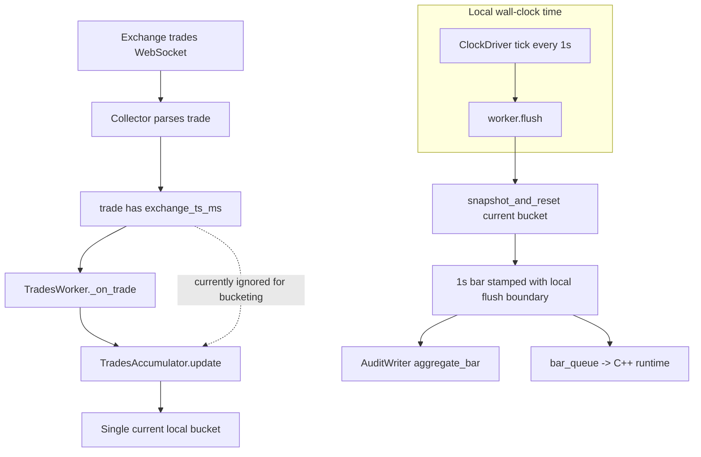
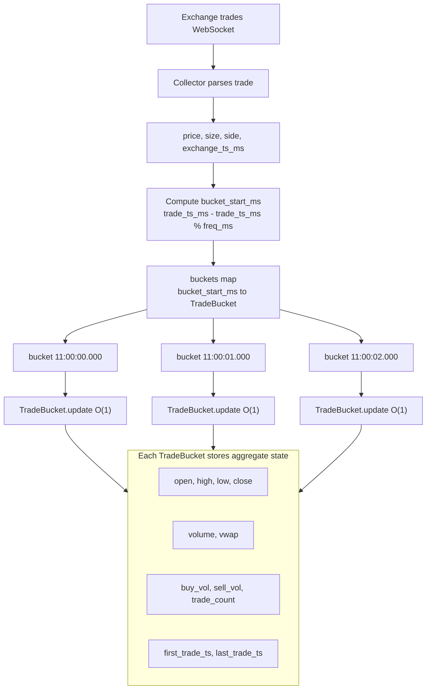
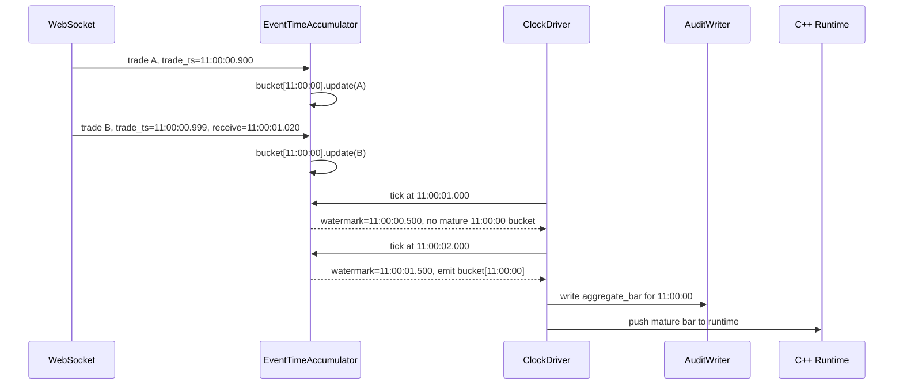
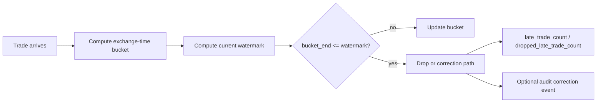
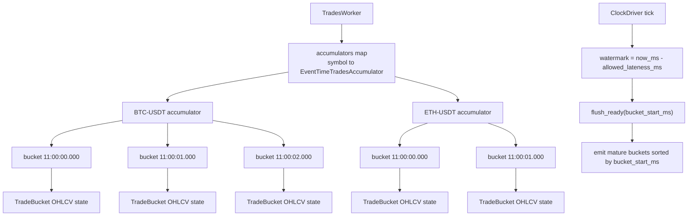
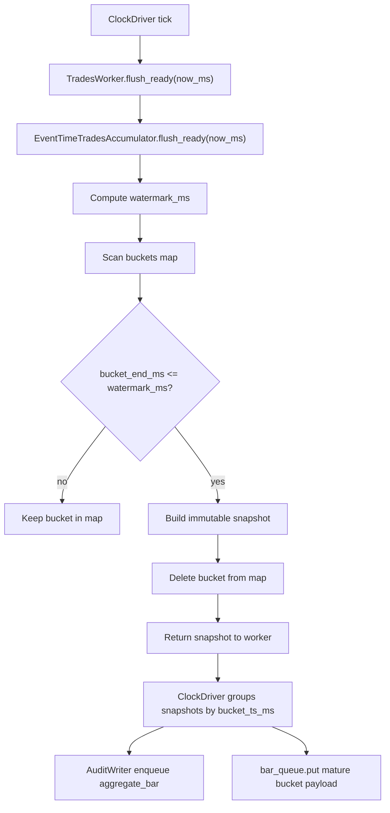

# Exchange-Time Trades Aggregation + Allowed Lateness 设计说明

> 日期：2026-05-26
> 状态：设计文档，暂未实现
> 范围：解释如何把当前 trades 聚合从本地 receive-time bucket 改成交易所 event-time bucket，并用 `allowed_lateness` 处理迟到 trades

---

## 1. 这份文档解决什么问题

当前 Binance / OKX trades dataflow 的核心语义是：

```text
WebSocket message 到达本地
  -> TradesAccumulator.update()
  -> ClockDriver 按本地 wall-clock 每 1s flush
  -> snapshot_and_reset() 得到这一秒的 bar
```

也就是说，当前 1s bar 是：

```text
本地两次 ClockDriver flush 之间收到的 trades 聚合
```

不是：

```text
交易所成交时间落在这一秒内的 trades 聚合
```

这会导致和交易所官方 kline 对账时出现边界差异：

```text
exchange trade time = 10:00:00.999
local receive time  = 10:00:01.005

交易所官方 kline:
  这笔 trade 属于 10:00:00 这一秒 / 这一分钟

当前 receive-time 聚合:
  如果 10:00:01.000 已经 flush，这笔 trade 会进入下一秒
```

所以，如果目标是更接近交易所官方 kline，需要改成：

```text
按 exchange trade timestamp 分桶
+ 用 allowed_lateness 延迟关闭 bucket
```

---

## 2. 当前实现在哪里聚合

### 2.1 WebSocket collector

Binance aggTrade message 已经带交易所 trade time：

```python
ts_ms = int(data["T"])
self.on_trade(unified_sym, px, sz, side, ts_ms)
```

OKX trades message 也有 exchange timestamp。

### 2.2 TradesWorker

当前 worker 收到 trade 后：

```python
def _on_trade(self, symbol, px, sz, side, ts_ms):
    acc.update(px, sz, side)
```

注意：`ts_ms` 已经传进来了，但没有被 accumulator 使用。

### 2.3 TradesAccumulator

当前 accumulator 只维护一个“当前 bucket”的 O(1) 聚合状态：

```text
_open
_high
_low
_close
_sum_v
_sum_pv
_buy_vol
_sell_vol
_count
```

ClockDriver flush 时：

```python
snap = acc.snapshot_and_reset()
```

这意味着：

```text
flush 之前收到的都进入当前 bucket
flush 之后收到的都进入下一个 bucket
```

---

## 3. 目标语义

目标是把 trades bar 定义改成：

```text
bar[exchange_bucket_start, exchange_bucket_end)
  = 所有 exchange trade timestamp 落在这个区间的 trades 聚合
```

例如 `freq=1s`：

```text
bucket_start = trade_ts_ms - (trade_ts_ms % 1000)
```

一笔 trade：

```text
trade_ts = 10:00:00.999
```

必须进入：

```text
10:00:00.000 - 10:00:00.999
```

即使它本地 10:00:01.005 才收到。

---

## 4. 为什么需要 allowed_lateness

如果按 exchange timestamp 分桶，ClockDriver 到边界时不能马上关闭刚结束的 bucket。

否则会遇到：

```text
10:00:01.000 ClockDriver 要输出 10:00:00 bucket
10:00:01.005 收到一笔 trade_ts=10:00:00.999 的 trade
```

这笔 trade 属于刚刚输出的 bucket，但输出已经完成。

所以我们需要等待一个小窗口：

```text
allowed_lateness = 500ms / 1000ms / 2000ms
```

含义是：

```text
只有当当前本地时间超过 bucket_end + allowed_lateness
才认为这个 exchange-time bucket 可以关闭并输出
```

---

## 5. 新 flush 语义

设：

```text
freq_ms = 1000
allowed_lateness_ms = 500
now_ms = 本地当前时间
watermark_ms = now_ms - allowed_lateness_ms
```

ClockDriver 每次 tick 时，不是简单切当前 accumulator，而是：

```text
flush all buckets where bucket_end_ms <= watermark_ms
```

对于 1s bucket：

```text
bucket_end_ms = bucket_start_ms + 1000
```

示例：

```text
10:00:00.900 trade A arrives, trade_ts=10:00:00.890
10:00:01.020 trade B arrives, trade_ts=10:00:00.999

Clock tick 10:00:01.000:
  watermark = 10:00:00.500
  10:00:00 bucket not closed

Clock tick 10:00:02.000:
  watermark = 10:00:01.500
  10:00:00 bucket closed and emitted
```

代价是：

```text
实时信号延迟约等于 allowed_lateness，再加上最多一个 ClockDriver tick 粒度
```

如果 `freq=1s` 且 ClockDriver 仍每 1s tick：

```text
allowed_lateness=500ms
实际输出可能晚 1 个 tick 左右
```

如果想更精细，可以让 ClockDriver tick 仍是 1s，但 flush 时输出“所有已成熟 bucket”；实现简单，延迟可接受。

### 5.1 三条独立规则（实现时必须分开实现）

event-time + allowed_lateness 方案里有 **三条语义上独立、不能混用的规则**。实现时建议写成三个明确的分支，而不是“收到 trade 就 update 当前桶”或“tick 到了就 snapshot 当前 accumulator”。

#### 规则 1：分桶 —— 只看交易所时间，不看本地收到时间

```text
bucket_start_ms = trade_ts_ms - (trade_ts_ms % freq_ms)
bucket_end_ms   = bucket_start_ms + freq_ms
```

- 每笔 trade 到达时，**先用 `trade_ts_ms` 计算它属于哪个 exchange-time bucket**
- **本地 `receive_ts_ms` 不参与分桶**
- 即使 trade 本地晚到、甚至本地时间已经跨秒，只要 `trade_ts_ms` 还在上一秒，就必须进入上一秒的 bucket

#### 规则 2：迟到判定 —— trade 到达时刻立即检查，与 flush tick 无关

trade 到达时（`update()` 入口），立刻计算当前 watermark：

```text
watermark_ms = receive_ts_ms - allowed_lateness_ms
```

如果：

```text
bucket_end_ms <= watermark_ms
```

说明这个 bucket 已经过了可接受窗口（要么即将被 flush，要么已经被 flush 并 delete），**这笔 trade 必须 drop**，不能创建或更新旧 bucket。

注意：

```text
迟到判定发生在 update() 入口
flush 发生在 ClockDriver tick
两者时间点不同，不能合并成一个逻辑
```

#### 规则 3：flush —— ClockDriver tick 时输出所有成熟 bucket

ClockDriver 每次 tick（`now_ms`）：

```text
watermark_ms = now_ms - allowed_lateness_ms
emit all buckets where bucket_end_ms <= watermark_ms
按 bucket_start_ms 升序输出
snapshot 后立刻从 buckets map 中 delete
```

一次 tick 可能 emit 0 根、1 根或多根 bar（系统卡顿时可能补吐多个成熟 bucket）。

#### 三条规则的关系

```text
trade 到达
  -> [规则 1] 按 trade_ts_ms 计算 bucket_start_ms
  -> [规则 2] 若 bucket_end_ms <= receive_watermark，drop
  -> 否则 update bucket[bucket_start_ms]

ClockDriver tick
  -> [规则 3] 若 bucket_end_ms <= tick_watermark，emit + delete
```

**常见错误**：只在 flush 时做分桶或只在 flush 时做 drop。正确做法是 **update 入口做分桶 + 迟到 drop，tick 入口做成熟 flush**。

---

### 5.2 详细示例 A：本地同一窗口内收到跨秒 trade

以下示例用于澄清“本地收到时间相同/接近，但 exchange time 不同”时的分桶与 flush 行为。

参数：

```text
freq_ms = 1000
allowed_lateness_ms = 500
```

两笔 trade 都在 **本地 10:00:01.000 ~ 10:00:01.500** 之间收到：

| Trade | 交易所时间 `trade_ts_ms` | 本地收到时间 `receive_ts_ms`（举例） |
|-------|--------------------------|--------------------------------------|
| Y | 10:00:00.990 | 10:00:01.100 |
| X | 10:00:01.100 | 10:00:01.300 |

#### Step 1：分桶（规则 1）

```text
Trade Y: bucket_start = 10:00:00.000, bucket_end = 10:00:01.000  -> bucket[10:00:00]
Trade X: bucket_start = 10:00:01.000, bucket_end = 10:00:02.000  -> bucket[10:00:01]
```

虽然两笔都是本地 10:00:01.xxx 才收到，但：

- Y 的 exchange time 仍在 **10:00:00 这一秒** → 进 `bucket[10:00:00]`
- X 的 exchange time 已在 **10:00:01 这一秒** → 进 `bucket[10:00:01]`

**不能**因为“本地都在 10:00:01 收到”就把它们放进同一个 bucket。这正是 event-time 方案与当前 receive-time 方案的核心差异。

#### Step 2：到达时迟到判定（规则 2）

Trade Y 到达时（`receive_ts_ms = 10:00:01.100`）：

```text
watermark = 10:00:01.100 - 500 = 10:00:00.600
bucket_end = 10:00:01.000
10:00:01.000 <= 10:00:00.600 ? 否 -> 允许 update bucket[10:00:00]
```

Trade X 到达时（`receive_ts_ms = 10:00:01.300`）：

```text
watermark = 10:00:01.300 - 500 = 10:00:00.800
bucket_end = 10:00:02.000
10:00:02.000 <= 10:00:00.800 ? 否 -> 允许 update bucket[10:00:01]
```

在 **10:00:01.000 ~ 10:00:01.500** 窗口内收到的 Y，都不会被 drop。

Trade Y 的 drop 边界：

```text
若 receive_ts_ms >= 10:00:01.501:
  watermark = receive_ts_ms - 500 >= 10:00:01.001
  bucket_end = 10:00:01.000
  10:00:01.000 <= watermark -> drop
```

即：对 `bucket[10:00:00]` 而言，本地收到时间最晚不能超过 **10:00:01.500**（恰好等于 `bucket_end + allowed_lateness`）。

#### Step 3：map 状态（两笔都收到后、第一次 flush 前）

```text
buckets = {
  10:00:00.000 -> TradeBucket { ..., trade_count 含 Y }
  10:00:01.000 -> TradeBucket { ..., trade_count 含 X }
}
```

两个 bucket **同时存在于 map 中**。这不是 bug，而是 event-time map 分桶的正常状态。

#### Step 4：逐 tick flush（规则 3）

```text
Tick 10:00:01.000 (now_ms = 10:00:01.000):
  watermark = 10:00:00.500
  bucket[10:00:00] end=10:00:01.000 > watermark -> 不 emit
  bucket[10:00:01] end=10:00:02.000 > watermark -> 不 emit
  （此时 Y、X 可能尚未到达）

Tick 10:00:02.000 (now_ms = 10:00:02.000):
  watermark = 10:00:01.500
  bucket[10:00:00] end=10:00:01.000 <= watermark -> emit，delete
  bucket[10:00:01] end=10:00:02.000 >  watermark -> 保留

Tick 10:00:03.000 (now_ms = 10:00:03.000):
  watermark = 10:00:02.500
  bucket[10:00:01] end=10:00:02.000 <= watermark -> emit，delete
```

emit 顺序：先 `10:00:00`（含 Y），再 `10:00:01`（含 X）。bar 的时间戳应对齐 `bucket_start_ms`（或文档约定的 bucket end，但全链路必须统一）。

#### 与 receive-time 方案的对比

若仍用当前 receive-time 聚合：

```text
10:00:01.xxx 收到的 Y 和 X 都会进入“当前 accumulator”
10:00:01.000 tick 已 flush 时，Y 可能尚未到达 -> Y 被错误归入下一秒
即使 Y 在 10:00:01.100 到达，也会和 X 混在同一根 bar 里
```

event-time 方案下，Y 会被正确归入 `10:00:00` bucket，并在 `10:00:02.000` tick 随该 bucket 一起 emit。

---

### 5.3 详细示例 B：文档原始单 bucket 迟到 case

参数同上（`allowed_lateness_ms = 500`）。

```text
10:00:00.900  Trade A arrives, trade_ts=10:00:00.890  -> bucket[10:00:00]
10:00:01.020  Trade B arrives, trade_ts=10:00:00.999  -> bucket[10:00:00]
```

Trade B 到达时迟到判定：

```text
watermark = 10:00:01.020 - 500 = 10:00:00.520
bucket_end = 10:00:01.000
10:00:01.000 <= 10:00:00.520 ? 否 -> 允许 update
```

```text
Tick 10:00:01.000: watermark=10:00:00.500 -> bucket[10:00:00] 不 emit（B 可能尚未到达）
Tick 10:00:02.000: watermark=10:00:01.500 -> bucket[10:00:00] emit（含 A + B）
```

---

### 5.4 超迟到 trade：bucket 已 emit 后到达

若 trade 的 exchange time 远早于当前时间（例如 `trade_ts = 11:00:00.990`，本地 `10:00:01.xxx` 收到），则：

```text
bucket_start = 11:00:00.000
bucket_end   = 11:00:01.000
```

- 若 `bucket[11:00:00]` 已在更早的 tick emit 并 delete → **drop**，记 `dropped_late_trade_count`
- 第一版 **不做 runtime 回滚**，也不重建已输出的 bucket

这与 5.2 中“本地晚到但 exchange time 仍在 allowed_lateness 窗口内”的 case 不同：前者 bucket 尚未 emit，后者 bucket 已经不存在。

---

### 5.5 实现伪代码（推荐直接对照实现）

```python
def update(px, sz, side, trade_ts_ms, receive_ts_ms):
    bucket_start_ms = trade_ts_ms - (trade_ts_ms % freq_ms)
    bucket_end_ms = bucket_start_ms + freq_ms

    # 规则 2：到达时迟到判定（用 receive_ts_ms，不是 trade_ts_ms）
    receive_watermark_ms = receive_ts_ms - allowed_lateness_ms
    if bucket_end_ms <= receive_watermark_ms:
        dropped_late_trade_count += 1
        late_trade_count += 1
        return

    # 规则 1：分桶 update
    bucket = buckets.setdefault(bucket_start_ms, TradeBucket(bucket_start_ms))
    bucket.update(px, sz, side, trade_ts_ms, receive_ts_ms)


def flush_ready(now_ms: int) -> list[TradeBucketSnapshot]:
    # 规则 3：tick 时成熟 flush（用 now_ms，不是 receive_ts_ms）
    tick_watermark_ms = now_ms - allowed_lateness_ms
    ready_keys = sorted(
        bucket_start_ms
        for bucket_start_ms in buckets
        if bucket_start_ms + freq_ms <= tick_watermark_ms
    )
    snapshots = []
    for bucket_start_ms in ready_keys:
        bucket = buckets.pop(bucket_start_ms)
        snapshots.append(bucket.snapshot(is_complete=True))
    return snapshots
```

#### 实现检查清单

实现完成后，至少验证以下 invariant：

```text
[分桶] update() 内 bucket_start_ms 只依赖 trade_ts_ms，不依赖 receive_ts_ms
[迟到] update() 入口的 watermark 使用 receive_ts_ms（或 now_ms），不是 trade_ts_ms
[flush] flush_ready() 的 watermark 使用 ClockDriver tick 的 now_ms
[delete] emit 后 bucket 立刻从 map 删除；delete 后同 bucket_start_ms 的新 trade 走 late-drop，不重建
[多桶] 同一 symbol 的 map 中允许同时存在多个 bucket（如 10:00:00 和 10:00:01）
[顺序] 一次 flush_ready 返回多根 bar 时，按 bucket_start_ms 升序
[空桶] forward-fill 空 bucket 的逻辑只作用于“成熟且 active symbol”的 bucket，见第 15 节
```

#### 常见实现错误

| 错误 | 后果 |
|------|------|
| 用 `receive_ts_ms` 计算 `bucket_start_ms` | 退化为 receive-time 聚合，与官方 kline 仍不对齐 |
| 只在 flush tick 做迟到 drop，update 时不检查 | 已 emit 的 bucket 被迟到 trade 重建，audit/runtime 不一致 |
| flush 后未 delete bucket | map 内存泄漏；迟到 trade 重复修改已输出 bar |
| update 与 flush 共用同一个 watermark 变量但时间点混用 | 边界 trade 有时被误 drop，有时被误保留 |
| 假设 map 中永远只有 1 个 bucket | 跨秒迟到 trade 会覆盖或丢失数据 |
| 一次 tick 只 emit 最后一根成熟 bucket（方案 A） | 系统卡顿时丢失中间 bucket |

---

## 6. 流程图对比

### 6.1 当前 receive-time 聚合流程



当前流程的关键点：

```text
trade_ts_ms 已经解析出来，但没有参与分桶
trade 属于哪个 bucket 取决于它什么时候到达本地并 update accumulator
```

### 6.2 目标 exchange-time map 分桶流程



目标流程的关键点：

```text
每笔 trade 按 exchange timestamp 进入正确 bucket
bucket 由 dict/map 自然创建，不固定成 previous/current/next 三个字段
即使本地迟到，只要还没超过 allowed_lateness，就能补进原本那一秒
每个 bucket 内只维护聚合状态，不保存 raw trade list
```

### 6.3 ClockDriver watermark flush



这里的 `allowed_lateness=500ms`。所以 `11:00:00` bucket 不会在 `11:00:01.000` 立刻输出，而是等到 watermark 越过 `11:00:01.000` 之后才输出。

### 6.4 超迟到 trade 的处理



第一版建议走：

```text
drop + metrics
```

不做 runtime 回滚。

### 6.5 推荐的 map 分桶结构



这个结构让 `ClockDriver` 的职责变得很清楚：它只推进时间和 watermark；具体每个 symbol 在某个时间点有没有 bucket，由 `TradesWorker` / `EventTimeTradesAccumulator` 的 map 自然表达。

---

## 7. 新数据结构

当前：

```text
TradesAccumulator
  只有一个 current bucket 状态
```

建议改成：

```text
EventTimeTradesAccumulator
  buckets: dict[int, TradeBucket]
  last_close: float
  late_trade_count: int
  dropped_late_trade_count: int
```

其中 key 是：

```text
bucket_start_ms
```

这是第一版推荐的核心设计：**用 map/dict 直接把 exchange-time bucket 映射到对应的 accumulator 状态**。

```text
symbol -> EventTimeTradesAccumulator
           -> buckets[bucket_start_ms] -> TradeBucket
```

例如：

```text
BTC-USDT -> buckets[11:00:00.000] -> BTC 这一秒的 OHLCV 聚合状态
BTC-USDT -> buckets[11:00:01.000] -> BTC 下一秒的 OHLCV 聚合状态
ETH-USDT -> buckets[11:00:00.000] -> ETH 这一秒的 OHLCV 聚合状态
```

这样 `ClockDriver` 不需要知道 trade 的到达顺序，也不需要维护 “当前桶” 的概念。它只需要按当前时间推进 watermark，然后向 worker 要：

```text
所有 bucket_end_ms <= watermark_ms 的成熟桶
```

第一版实现应只使用 `dict[int, TradeBucket]`，让 bucket 数量由数据自然决定；不要在代码里维护固定的 `previous/current/next` 字段。

`TradeBucket` 维护：

```text
bucket_start_ms
open
high
low
close
sum_v
sum_pv
buy_vol
sell_vol
trade_count
first_trade_ts_ms
last_trade_ts_ms
first_receive_ts_ms
last_receive_ts_ms
```

每来一笔 trade：

```python
def update(px, sz, side, trade_ts_ms, receive_ts_ms=None):
    bucket_start = trade_ts_ms - (trade_ts_ms % freq_ms)
    bucket = buckets.setdefault(bucket_start, TradeBucket(bucket_start))
    bucket.update(px, sz, side, trade_ts_ms, receive_ts_ms)
```

---

## 8. map 分桶，而不是固定三桶

第一版实现必须使用 map 管理 exchange-time bucket：

```python
buckets: dict[int, TradeBucket]
```

其中 key 是：

```text
bucket_start_ms = trade_ts_ms - (trade_ts_ms % freq_ms)
```

不要在代码里固定维护：

```text
previous_bucket
current_bucket
next_bucket
```

原因是固定三桶会把实现和“正常网络情况下通常只看到 2-3 个 bucket”这个现象绑死。实际系统需要处理：

```text
迟到 trade
乱序 trade
进程短暂停顿后一次 flush 多个成熟 bucket
交易所补发或 WebSocket 抖动
动态 symbol list add/remove 边界
```

这些场景下，map 更自然：

```text
trade arrives
  -> compute bucket_start_ms from exchange timestamp
  -> bucket = buckets.setdefault(bucket_start_ms, TradeBucket(bucket_start_ms))
  -> bucket.update(...)
```

如果 `freq=1s`，正常网络下这个 map 大多只会短暂包含类似下面几个 key：

```text
bucket[11:00:00]
bucket[11:00:01]
bucket[11:00:02]
```

这可以被口头理解成 previous/current/next，但它不是实现结构。实现只认 `bucket_start_ms -> TradeBucket`。

---

## 9. 聚合时机：实时流式 O(1) 聚合

实时主路径必须采用流式 O(1) 聚合：

```text
trade arrives
  -> 按 trade_ts_ms 找 bucket
  -> bucket.update(price, size, side, trade_ts_ms, receive_ts_ms)

flush mature bucket
  -> bucket.snapshot()
  -> delete bucket
```

`TradeBucket` 只维护聚合状态：

```text
open
high
low
close
sum_v
sum_pv
buy_vol
sell_vol
trade_count
first_trade_ts_ms
last_trade_ts_ms
first_receive_ts_ms
last_receive_ts_ms
```

每笔 trade 都是 O(1) 更新：

```python
if bucket.trade_count == 0:
    bucket.open = px
bucket.high = max(bucket.high, px)
bucket.low = min(bucket.low, px)
bucket.close = px
bucket.sum_v += sz
bucket.sum_pv += px * sz
bucket.trade_count += 1
```

注意：`open/close` 应该按 exchange trade time 语义定义。如果 WebSocket 保证单 symbol 内 trade 基本按 exchange time 有序，直接用到达顺序更新 open/close 通常可行；如果要更严格，则 bucket 需要保存：

```text
first_trade_ts_ms + first_trade_price
last_trade_ts_ms + last_trade_price
```

更新时：

```python
if trade_ts_ms < first_trade_ts_ms:
    open = px
if trade_ts_ms >= last_trade_ts_ms:
    close = px
```

这样即使同一个 bucket 内极少数 trade 乱序到达，open/close 仍按 exchange timestamp 对齐。

这个方案是第一版实时实现的唯一推荐方案，因为：

```text
内存小
实时路径稳定
flush 很轻
和当前 TradesAccumulator 的 O(1) 聚合模型一致
```

### 9.1 非实时调试方案：保存 raw trades list

bucket 内保存原始 aggTrades list，然后 flush 时一次性聚合，只适合 debug / offline replay，不进入实时主路径。

流程：

```text
trade arrives
  -> 按 trade_ts 找 bucket
  -> append raw trade 到 bucket.trades

flush mature bucket
  -> 遍历 bucket.trades
  -> 一次性计算 open/high/low/close/volume/vwap
```

优点：

```text
最直观
便于 debug 和 replay
可以重新排序 / 去重
```

缺点：

```text
内存随 trade 数增长
活跃 symbol 的 1s bucket 可能有很多 trades
flush 时计算集中在 ClockDriver 路径上，可能造成抖动
需要处理 list 排序、重复 trade、超大 bucket
```

这个方式可以作为可选 debug 工具，但不要让生产 worker 依赖它。

---

## 10. flush_ready 的设计

新的 accumulator 不再提供简单的 `snapshot_and_reset()`，而是提供：

```python
def flush_ready(now_ms: int) -> list[dict]:
    watermark = now_ms - allowed_lateness_ms
    ready = [
        bucket for bucket in buckets
        if bucket.bucket_start_ms + freq_ms <= watermark
    ]
    emit ready buckets sorted by bucket_start_ms
    delete emitted buckets
```

返回可能是多根 bar：

```text
[]                 没有成熟 bucket
[bucket t]         正常情况
[bucket t, t+1]    如果系统卡顿，补吐多个成熟 bucket
```

这点和现在 `flush()` 每个 symbol 只返回一根 bar 不同。

`flush_ready()` 必须只处理 map 里的成熟 bucket：

```text
遍历 buckets
找出 bucket_end_ms <= watermark_ms 的 bucket
按 bucket_start_ms 排序输出
从 buckets 里删除已输出 bucket
```

它不应该依赖 previous/current/next 这种固定桶字段。

### 10.1 bucket 生命周期与 delete / audit 边界

map 中每个 `TradeBucket` 的生命周期应该很明确：

```text
1. create
   第一笔属于 bucket_start_ms 的 trade 到达时创建

2. streaming update
   后续属于同一个 bucket_start_ms 的 trade 持续 O(1) 更新聚合状态

3. mature
   ClockDriver tick 时，watermark_ms = now_ms - allowed_lateness_ms
   如果 bucket_start_ms + freq_ms <= watermark_ms，则 bucket 成熟

4. snapshot
   accumulator 把成熟 bucket 转成不可变 snapshot

5. delete from map
   snapshot 成功生成后，立刻从 buckets map 中删除该 bucket

6. hand off
   snapshot 返回给 TradesWorker / ClockDriver

7. audit + runtime
   ClockDriver 负责写 aggregate audit，并把 bar payload 推给 runtime
```

也就是说，**map 必须删除久远时间戳的 bucket**，否则会造成内存泄漏；但 **accumulator 不直接写 audit**。职责边界应该是：

```text
EventTimeTradesAccumulator:
  负责 bucket 创建、流式聚合、成熟判断、snapshot、delete

TradesWorker:
  负责按 symbol 收集 accumulator.flush_ready(now_ms) 的 snapshots

ClockDriver:
  负责按 bucket_ts_ms 汇总 worker 返回的 mature buckets
  负责写 aggregate audit
  负责 bar_queue.put(...)

AuditWriter:
  负责异步落盘和文件轮转
```

推荐的 `flush_ready()` 语义：

```python
def flush_ready(now_ms: int) -> list[TradeBucketSnapshot]:
    watermark_ms = now_ms - allowed_lateness_ms
    ready_keys = sorted(
        bucket_start_ms
        for bucket_start_ms in buckets
        if bucket_start_ms + freq_ms <= watermark_ms
    )

    snapshots = []
    for bucket_start_ms in ready_keys:
        bucket = buckets.pop(bucket_start_ms)
        snapshots.append(bucket.snapshot(is_complete=True))

    return snapshots
```

注意这里的顺序：

```text
先 snapshot，再 delete，再返回 snapshot
```

delete 后如果又收到属于同一个 `bucket_start_ms` 的 trade，说明它已经超过 `allowed_lateness`，应该进入 late-trade 处理逻辑，而不是重新创建旧 bucket 继续修改已经输出的 bar。

### 10.2 delete 与 audit 流程图



这个流程避免了两个问题：

```text
accumulator 直接落盘会把聚合状态管理和 I/O 耦合在一起
delete 不及时会让 buckets map 随运行时间持续增长
```

为了不大改下游，有三个接入选择。

---

## 11. 实现选择 A：ClockDriver 仍每 tick 输出一轮，但 worker 只吐最新成熟 bucket

接口：

```python
worker.flush(now_ms) -> dict[symbol, ndarray]
```

每个 symbol 只返回“当前最老的成熟 bucket”或“所有成熟 bucket 中最后一根”。

优点：

```text
改动小
ClockDriver / Engine / audit 结构基本不变
```

缺点：

```text
如果某次 flush 发生卡顿，可能丢中间成熟 bucket
不适合严格 audit
```

不建议。

---

## 12. 实现选择 B：ClockDriver 支持每 tick 多 bucket 输出

接口：

```python
worker.flush(now_ms) -> list[tuple[bucket_ts_ms, bars, trades]]
```

ClockDriver 每次 tick：

```text
raw = worker.flush_ready(now_ms)
for each mature bucket_ts:
    aggregate same bucket_ts across workers
    write audit
    bar_queue.put(payload)
```

优点：

```text
不会丢成熟 bucket
audit 可以严格保留每个 exchange-time bucket
更接近 replay / verifier 语义
```

缺点：

```text
ClockDriver 改动较大
worker 返回类型需要版本化
需要测试多 bucket flush 顺序
```

推荐中期采用这个方案。

---

## 13. 实现选择 C：只改 trades worker，ClockDriver 不感知多 bucket

worker 内部保存一个成熟 bucket queue：

```text
flush(now_ms):
  accumulator.flush_ready(now_ms) 追加到 ready_queue
  pop ready_queue[0] 返回
```

如果 ready_queue 里有积压，每个 ClockDriver tick 只吐一根。

优点：

```text
ClockDriver 改动最小
可以逐步迁移
```

缺点：

```text
如果 ready_queue 积压，会引入额外延迟
bar_queue 的 tick 和 bucket_ts 不再一一对应
```

可以作为第一版落地方案。

---

## 14. 迟到 trade 如何处理

> **详细分桶 / flush / drop 时序与实现伪代码见第 5.1 ~ 5.5 节。** 本节只总结策略选型。

定义：

```text
watermark_ms = now_ms - allowed_lateness_ms
```

当一笔 trade 到达时：

```text
trade bucket end <= current watermark
```

说明它已经晚于可接受窗口。

处理策略：

### 14.1 第一版：drop + metrics

drop 条件与 5.1 规则 2 一致：trade 到达时（不是 flush tick 时）检查：

```python
receive_watermark_ms = receive_ts_ms - allowed_lateness_ms
if bucket_end_ms <= receive_watermark_ms:
    dropped_late_trade_count += 1
    return
```

注意：`bucket_end_ms` 由 **exchange `trade_ts_ms`** 计算；`receive_watermark_ms` 由 **本地 `receive_ts_ms`** 计算。两者不可混用。

同时记录：

```text
late_trade_count
dropped_late_trade_count
max_lateness_ms
```

优点：

```text
实时 runtime 不回滚
实现简单
```

缺点：

```text
极少数超迟 trades 不会进入 factor
```

### 14.2 第二版：audit correction event

对已经输出的 bucket，如果后来又收到迟到 trade：

```text
写 correction event 到 audit
不修改 runtime
```

适合离线 replay / verifier。

### 14.3 第三版：runtime replay / rollback

收到迟到 trade 后修正历史 bucket 并重放因子。

不建议第一阶段做，因为 stateful rolling factor 回滚成本高。

---

## 15. 空 bucket 和 forward fill

当前 accumulator 在没有 trades 时会 forward-fill OHLC 和 vwap：

```text
open/high/low/close = last_close
volume = 0
vwap = last_close
```

event-time bucket 也应该保留这个行为，但要明确：

```text
只有当某个 symbol 是 active symbol，且该 bucket 成熟时，才输出空 bucket
```

否则会造成：

```text
symbol 未订阅期间也产生 forward-fill bars
```

所以 worker 需要知道 active symbol 时间段，或者简单地：

```text
当前 active symbols 中每个 symbol 都在每个成熟 bucket 输出一根 bar
removed symbol 从下一版本开始不再输出
added symbol 从它创建 accumulator 之后开始输出
```

动态 symbol 场景下，这和当前 post-flush commit 语义是一致的。

---

## 16. 动态 symbol list 下的语义

当前 dynamic symbol commit 发生在 post-flush：

```text
ClockDriver flush old universe
commit symbol_diff
worker rebuild
runtime consume symbol_diff
```

event-time + allowed_lateness 后要注意：

```text
ClockDriver flush 的 bucket 可能是 allowed_lateness 之前的旧 bucket
```

因此 `symbol_diff` 的 effective timestamp 应该表示：

```text
从哪个 exchange-time bucket 起，新 universe 生效
```

建议：

```text
effective_from_ts_ms = next_exchange_bucket_start_after_commit
```

而不是简单地用当前 wall-clock bucket。

第一版可以简化：

```text
commit 时立即更新 active symbols
新增 symbol 的 accumulator 从创建时刻之后的 bucket 开始输出
删除 symbol 的 accumulator flush_ready 后移除
```

但严格 verifier 要理解这些边界 bucket 可能是 partial。

---

## 17. Audit 字段建议

为了之后排查是否对齐交易所，需要扩展 audit 字段：

```text
bucket_ts_ms              exchange-time bucket start or end
bucket_time_basis         "exchange_time" / "receive_time"
allowed_lateness_ms
source_count              当前 bucket 内 trade / sub-bar 数
first_trade_ts_ms
last_trade_ts_ms
first_receive_ts_ms
last_receive_ts_ms
late_trade_count
dropped_late_trade_count
max_lateness_ms
is_complete               bucket 是否经过 watermark 正常关闭
```

当前 verifier 看到这些字段后，可以区分：

```text
完整 exchange-time bucket
partial bucket
dynamic rebalance boundary bucket
late-drop affected bucket
```

---

## 18. Verifier 语义

如果采用 exchange-time bucket，和官方 kline 对比时应只使用：

```text
bucket_time_basis == "exchange_time"
is_complete == true
source_count / trade_count 正常
远离 symbol add/remove 边界
```

然后把 1s bars 聚合成 1m：

```text
1m OHLCV = 60 个 exchange-time 1s bars 聚合
```

这样和 Binance / OKX 官方 1m kline 会更接近。

如果仍然不一致，问题就更可能是：

```text
WS 漏消息
交易所 aggTrade 与 official kline 口径差异
REST/WS 数据源延迟或补发
```

---

## 19. 推荐分阶段实现

### Phase 1：文档和观测

新增 metrics，但不改语义：

```text
receive_ts_ms
trade_ts_ms
lateness_ms = receive_ts_ms - trade_ts_ms
```

统计：

```text
p50 / p95 / p99 lateness
max lateness
```

目的：先知道应该设多大的 `allowed_lateness_ms`。

### Phase 2：EventTimeTradesAccumulator

新增 accumulator，不替换旧实现：

```text
EventTimeTradesAccumulator(freq_ms, allowed_lateness_ms)
```

第一版内部结构固定为：

```text
buckets: dict[int, TradeBucket]
```

`TradeBucket` 采用流式 O(1) 聚合，不保存 raw trades list。

单元测试：

```text
同一秒乱序到达
迟到但未超过 allowed_lateness
超过 allowed_lateness 被 drop
空 bucket forward-fill
多 bucket flush_ready
```

### Phase 3：TradesWorker 接入

worker 增加配置：

```python
trade_time_mode = "receive_time" | "exchange_time"
allowed_lateness_ms = 1000
```

默认先保持：

```text
receive_time
```

避免破坏现有实时行为。

当 `trade_time_mode="exchange_time"` 时，worker 的 `_on_trade(..., ts_ms)` 必须把 exchange `ts_ms` 传入 `EventTimeTradesAccumulator.update(...)`，而不是像当前实现一样丢掉 `ts_ms`。

### Phase 4：ClockDriver 多 bucket 支持

如果需要严格保留每个成熟 bucket，升级 ClockDriver：

```text
一个 tick 可以 emit 多个 bucket payload
```

### Phase 5：Audit / verifier 增强

扩展 audit schema，verifier 支持：

```text
只比较 complete exchange-time buckets
按 dynamic universe timeline 排除 inactive periods
按 tick size 容忍微小差异
```

---

## 20. 推荐默认参数

建议初始：

```text
trade_time_mode = "receive_time"  # 默认兼容
allowed_lateness_ms = 1000        # exchange_time 模式下使用
drop_late_after_ms = 5000         # 超过这个直接 drop + metric
```

对低延迟实时因子：

```text
allowed_lateness_ms = 500 ~ 1000
```

对更严格的 audit / research：

```text
allowed_lateness_ms = 2000 ~ 5000
```

---

## 21. 一句话总结

当前 trades bar 是本地 receive-time 聚合：trade 到本地后先进入当前 accumulator，ClockDriver 到点 snapshot/reset。`allowed_lateness` 方案会把它改成 exchange-time 分桶：trade 按交易所 timestamp 进入对应 bucket，ClockDriver 只输出已经超过 watermark 的成熟 bucket。这样会牺牲一点实时延迟，但能显著提升和交易所官方 kline 的对齐程度。
